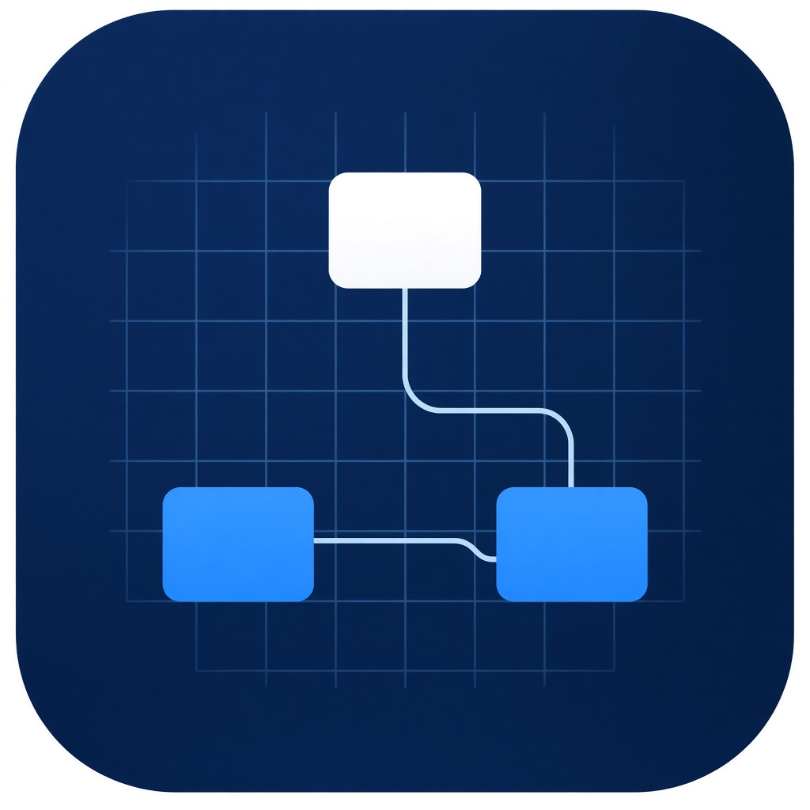
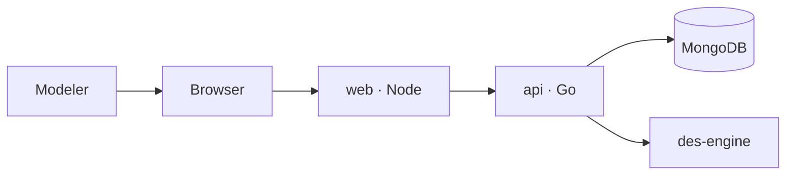

<<<<<<< HEAD
<p align="center">
  
</p>

<h1 align="center">Sim Studio</h1>

<p align="center">
A browser workbench for building and running simulation projects.<br>
One project can combine discrete-event flowcharts, agents, system dynamics, and industry-library blocks.<br>
The discrete-event clock is provided by <a href="https://github.com/cgcodeboy/des-engine">des-engine</a>.
</p>

<p align="center">
  <a href="README.zh-CN.md">中文</a> ·
  <a href="#quick-start">Quick start</a> ·
  <a href="#develop">Develop</a> ·
  <a href="#documentation">Documentation</a> ·
  <a href="#api">HTTP API</a>
</p>

Sim Studio is a single modeling workspace. A person builds a project in the browser, saves it through the API, and runs one experiment at a time. The browser holds the copy being edited and the undo stack for the current session. The saved project and the finished run record live in MongoDB.

The page, the API, and the database are three processes. The browser talks only to the page process. The page process serves the workspace and proxies `/api`. The API is a Go program. des-engine is a library linked into that program, not a network service.

## Contents

- [Capabilities](#capabilities)
- [Architecture](#architecture)
- [Repository layout](#repository-layout)
- [Requirements](#requirements)
- [Quick start](#quick-start)
- [Develop](#develop)
- [Configuration](#configuration)
- [HTTP API](#http-api)
- [Data](#data)
- [Documentation](#documentation)
- [Status](#status)
- [License](#license)

## Capabilities

The workspace is one canvas, not a set of product tabs.

- A new project starts with Main and Simulation.
- Blocks are added from the project tree. The canvas does not auto-connect them.
- Wires can be drawn by dragging, several wires can share the same ports, and a wire can be deleted. A block cannot link to itself.
- Run speed is 1×, 10×, or as fast as possible. Queue overflow is counted. It does not fail the run.
- One person, one active run. A second start is rejected while a run is active.
- Undo is the last 50 documents in the browser session. It is not stored in the database.

The model can hold more than one method in the same project:

| Method | Where the rule lives | Clock |
| --- | --- | --- |
| Process flowchart, resources, batching, measurement | `internal/pkgs/process` | des-engine |
| Conveyors, fleets, racks | `internal/pkgs/handling` | des-engine |
| Rail occupancy | `internal/pkgs/rail` | des-engine |
| Pedestrians | `internal/pkgs/pedestrian` | shell step, 0.1 model second |
| Roads | `internal/pkgs/road` | shell step, 0.1 model second |
| Fluid | `internal/pkgs/fluid` | shell step, 1 model second |
| Stocks and flows | `internal/pkgs/dynamics` | shell step, 1 model second |
| Statecharts, events, schedules, tables, short expressions | `internal/pkgs/behavior` | shell |
| Parameter variation and coordinate search | `internal/pkgs/experiment` | sequential re-runs inside the one active run |

A mixed flowchart-and-stock run is allowed. Queue counts are marked `engine`. Stock series are marked `dynamics`.

These inputs are refused and do not produce numbers: long Java, imports, external jars, in-model Python or R, a live Excel file, an external database, and map search or tiles. Sound is not played.

## Architecture



| Process | Role | Published port |
| --- | --- | --- |
| `web` | Serves the built workspace and proxies `/api` | `127.0.0.1:8080` |
| `api` | HTTP handlers, domain services, des-engine | none |
| `mongo` | Project documents and run records | none |

`api/server.go` only listens. `api/route.go` only registers paths. Each business has its own directory under `api/handlers`:

| Business | Directory | What it does |
| --- | --- | --- |
| Library | `api/handlers/library` | Returns the block catalog |
| Project | `api/handlers/project` | Reads and replaces a project. Checks for an active run before a write or a delete |
| Simulation | `api/handlers/simulation` | Assembles the solvers for one experiment, then asks the run-record domain to start, sample, pause, resume, stop, or change speed |

`api/handlers/respond` only writes HTTP responses. It is not a business.

Domains do not import each other. A handler is the place that combines them. Each domain has its own `domain`, `service`, and `repo` packages. The service depends on the repository interface in `domain`. Only `internal/app` connects a concrete repository to a service.

| Domain | Directory | Owns |
| --- | --- | --- |
| Library | `internal/pkgs/library` | Block types, ports, schemas, default appearance, solver kind |
| Model | `internal/pkgs/model` | The project document: agents, blocks, links, values, geometry, experiments |
| Process | `internal/pkgs/process` | Discrete-event flowchart rules |
| Handling | `internal/pkgs/handling` | Conveyors, fleets, racks |
| Pedestrian | `internal/pkgs/pedestrian` | Desired speed and separation |
| Road | `internal/pkgs/road` | Following distance |
| Rail | `internal/pkgs/rail` | Track occupancy |
| Fluid | `internal/pkgs/fluid` | Level and flow |
| Dynamics | `internal/pkgs/dynamics` | Stocks, flows, dynamic variables |
| Behavior | `internal/pkgs/behavior` | Statecharts, events, schedules, tables, short expressions |
| Experiment | `internal/pkgs/experiment` | Parameter rounds and coordinate search, at most 30 rounds |
| Run record | `internal/pkgs/record` | One record: status, speed, the single active slot, the final sample |

des-engine event handlers do not do IO and do not call `Stop`, `Wait`, `Pause`, `Resume`, or `Checkpoint`. Interactive pacing is a shell goroutine. The engine is created with real time off.

There is no login while the published port is bound to `127.0.0.1`. There is no message queue and no required WebSocket. There is no Kubernetes.

## Repository layout

```text
sim-studio/
  cmd/server/main.go          process entry
  api/server.go               listen
  api/route.go                path table
  api/handlers/library/       library business
  api/handlers/project/       project business
  api/handlers/simulation/    simulation business
  api/handlers/respond/       HTTP responses
  internal/app/               wires each repository into its service
  internal/pkgs/<domain>/     domain, service, and repo
  web/                        Vite + React workspace
  deploy/compose.yaml         web, api, and MongoDB
  deploy/api.Dockerfile
  docs/                       design documents and the logo
```

The module path is `github.com/cgcodeboy/sim-studio`. des-engine is not vendored. `go.mod` replaces it with the sibling checkout `../des-engine`. The API image build context is the parent of this repository so the image can copy both trees.

## Requirements

- Docker with Compose, for the three-process stack
- A sibling checkout of [des-engine](https://github.com/cgcodeboy/des-engine) when building the API outside that image
- Go 1.25 and Node.js 22 or newer, for local development

MongoDB is the official `mongo:7` image. The API waits for a journal acknowledgement before it reports a successful write. The database port is not published to the host.

## Quick start

From the directory that contains both `sim-studio` and `des-engine`:

```bash
docker compose -f sim-studio/deploy/compose.yaml up --build
```

Open http://127.0.0.1:8080/.

The page is the only published service. Saving a project and starting a run both go through it to the API, then to MongoDB. Refreshing the page reads the project back from the API.

Stop the stack with Ctrl-C, or:

```bash
docker compose -f sim-studio/deploy/compose.yaml down
```

`down` does not delete the named volume `mongo-data`. Add `-v` only when you mean to drop saved projects and run records.

## Develop

Local development uses the Vite server and a Go process on the host. des-engine must sit next to this repository:

```text
ai_program/
  des-engine/
  sim-studio/
```

Start MongoDB on `127.0.0.1:27017`, then in one terminal:

```bash
cd sim-studio
go run ./cmd/server
```

In another:

```bash
cd sim-studio/web
npm install
npm run dev
```

Open http://127.0.0.1:5173/. Vite proxies `/api` to `127.0.0.1:8080`.

Format and test the Go tree from the repository root:

```bash
gofmt -w api internal cmd
go test ./...
```

The web workspace has no second package manager and no MongoDB driver. `web/node_modules` and `web/dist` are ignored by `web/.gitignore`.

## Configuration

| Variable | Process | Default | Meaning |
| --- | --- | --- | --- |
| `SIM_MONGO` | api | `mongodb://127.0.0.1:27017` | MongoDB connection string. Compose sets `mongodb://mongo:27017` |
| `SIM_ADDR` | api | `:8080` | API listen address inside its own network namespace |
| `API_ORIGIN` | web | `http://api:8080` | Where the page process proxies `/api` |

The database name is `simstudio`.

## HTTP API

| Method | Path | Business |
| --- | --- | --- |
| `GET` | `/api/health` | process health |
| `GET` | `/api/library` | library |
| `GET` | `/api/projects` | project |
| `GET` | `/api/projects/{id}` | project |
| `PUT` | `/api/projects/{id}` | project |
| `DELETE` | `/api/projects/{id}` | project |
| `POST` | `/api/records` | simulation, start |
| `GET` | `/api/records/{id}` | simulation, current sample |
| `POST` | `/api/records/{id}/pause` | simulation |
| `POST` | `/api/records/{id}/resume` | simulation |
| `POST` | `/api/records/{id}/stop` | simulation |
| `POST` | `/api/records/{id}/speed` | simulation |

A project body is one JSON document. `revision` starts at 1. A caller sends `revision: 0` to create. A later save must send the revision it last read. The API replaces the document only when that revision still matches, then returns the next revision.

A start body is:

```json
{
  "requestId": "q…",
  "projectId": "…",
  "experimentId": "…",
  "speed": "x1"
}
```

`speed` is `x1`, `x10`, or `asap`. The same `requestId` returns the first record instead of starting another. The response field for the record is `recordId`.

Error codes are `invalid` (422), `notfound` (404), `conflict` or `rejected` (409), and `unavailable` (503).

## Data

Two collections matter to the product.

The project collection stores the whole project document. A save is one replacement of that document. Library definitions are not part of the project body.

The `records` collection stores one run record: request id, project, experiment, status (`running`, `paused`, `finished`, `interrupted`), speed, source, revision, the active flag, and the final sample. The sample stays empty until the run leaves the active state. An in-progress sample is memory only and is discarded when the API process stops. On startup the API marks any still-active record `interrupted` before it accepts traffic.

A partial unique index allows only one document with `active` equal to 1. There is no multi-document transaction. Project replacement and run-record updates are separate single-document writes, each acknowledged by the journal.

## Documentation

The design documents are the source for behavior that the code is still catching up to.

| Document | What it decides |
| --- | --- |
| [框架设计](docs/框架设计.md) | Quality scenarios, containers, domain boundaries, architecture decisions |
| [概要设计说明书](docs/概要设计说明书.md) | Module responsibilities and the path from a user action to a write |
| [详细设计说明书](docs/详细设计说明书.md) | Solver rules, source layout, and the tests those rules imply |
| [数据库设计说明书](docs/数据库设计说明书.md) | The `records` collection, indexes, and the revision rule |

## Status

The workspace, the HTTP API, the domain split, and the Compose file are in this tree. `go test ./...` covers project revisions, duplicate start requests, queue overflow, and a mixed flowchart-and-stock sample.

A machine without Docker and without MongoDB can open the Vite page, and the page will report that it cannot reach the API. That is the current local development requirement, not a second storage path in the browser.

The block catalog used by the canvas is still `web/src/catalog.js`. `GET /api/library` already serves the backend catalog. The page is not yet reading that response as its only type source.

Numbers on the canvas are des-engine results only when the sample says `source` is `engine`.

## License

Licensed under the [Apache License 2.0](LICENSE).
=======
# sim-studio
A browser workbench for building and running simulation projects. One project can combine discrete-event flowcharts, agents, system dynamics, and industry-library blocks, with the discrete-event clock provided by des-engine.
>>>>>>> f1b6bc673224ab24319154f29745f0b924dee1fa
