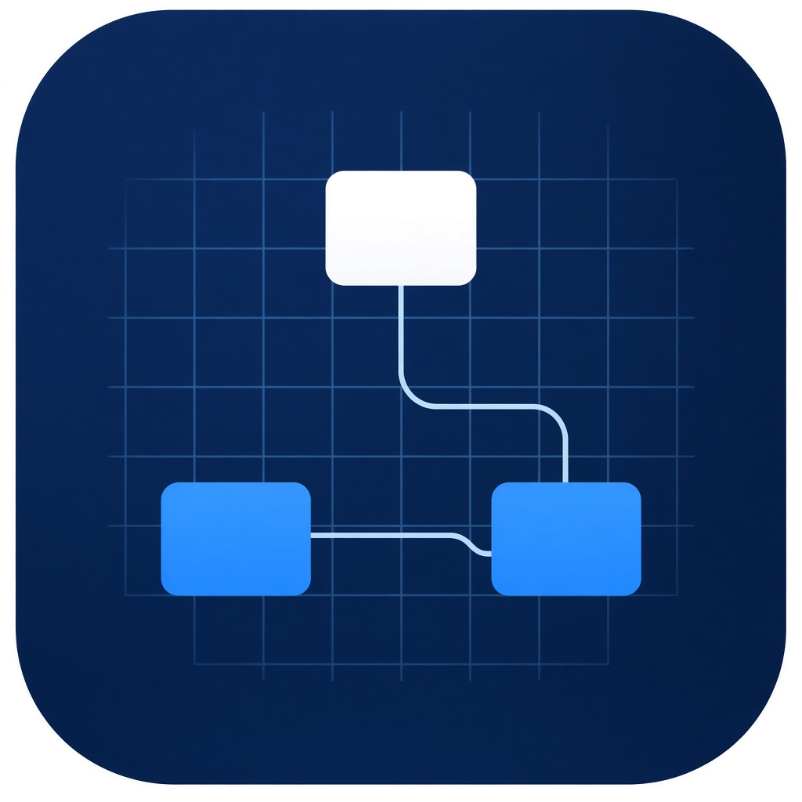
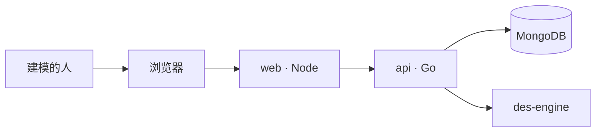

<p align="center">
  
</p>

<h1 align="center">仿真台</h1>

<p align="center">
浏览器里的仿真建模工作台。<br>
一个工程里可以同时搭建离散事件流程、智能体、系统动力学和行业库元件。<br>
离散事件时钟由 <a href="https://github.com/cgcodeboy/des-engine">des-engine</a> 提供。
</p>

<p align="center">
  <a href="README.md">English</a> ·
  <a href="#快速开始">快速开始</a> ·
  <a href="#本地开发">本地开发</a> ·
  <a href="#设计文档">设计文档</a> ·
  <a href="#http-接口">HTTP 接口</a>
</p>

仿真台是一个建模工作台。人在浏览器里建工程，通过接口保存，一次只跑一个实验。浏览器持有正在编辑的副本，以及本次会话的撤销栈。已保存的工程和已结束的运行记录在 MongoDB 里。

页面、接口和数据库是三个进程。浏览器只访问页面进程。页面进程提供工作台，并把 `/api` 转给接口。接口是一个 Go 程序。des-engine 作为库链进这个程序，不是网络服务。

## 目录

- [能力](#能力)
- [架构](#架构)
- [仓库布局](#仓库布局)
- [环境](#环境)
- [快速开始](#快速开始)
- [本地开发](#本地开发)
- [配置](#配置)
- [HTTP 接口](#http-接口)
- [数据](#数据)
- [设计文档](#设计文档)
- [现状](#现状)
- [许可](#许可)

## 能力

工作台是一块画布。

- 新建工程里只有 Main 和 Simulation。
- 元件从工程树加入。画布不会自动连线。
- 连线可以拖拽画出，同一对端口可以有多根连线，连线可以删除。元件不能连到自己。
- 运行速度是 1×、10× 或尽快。队列溢出只计数，不把这次运行判为失败。
- 一个人，一次活动运行。已有活动运行时，再开始一次会被拒绝。
- 撤销是浏览器会话里最近 50 份文档，不写入数据库。

同一个工程里可以同时放多种方法：

| 方法 | 规则所在 | 时钟 |
| --- | --- | --- |
| 流程图、资源、批处理、测量 | `internal/pkgs/process` | des-engine |
| 传送带、车队、货架 | `internal/pkgs/handling` | des-engine |
| 轨道占用 | `internal/pkgs/rail` | des-engine |
| 行人 | `internal/pkgs/pedestrian` | 外壳步进，0.1 模型秒 |
| 道路 | `internal/pkgs/road` | 外壳步进，0.1 模型秒 |
| 流体 | `internal/pkgs/fluid` | 外壳步进，1 模型秒 |
| 存量与流量 | `internal/pkgs/dynamics` | 外壳步进，1 模型秒 |
| 状态图、事件、日程、表、短表达式 | `internal/pkgs/behavior` | 外壳 |
| 参数变化与坐标搜索 | `internal/pkgs/experiment` | 同一次活动运行里顺序重跑 |

流程图和存量可以出现在同一次运行里。队列计数的来源是 `engine`。存量序列的来源是 `dynamics`。

这些输入会被拒绝，并且不产生数字：长 Java、import、外部 jar、模型内的 Python 或 R、打开的 Excel、外部数据库、地图检索和图块。声音不播放。

## 架构



| 进程 | 职责 | 发布到宿主机的端口 |
| --- | --- | --- |
| `web` | 提供构建后的工作台，并转发 `/api` | `127.0.0.1:8080` |
| `api` | HTTP 处理、领域服务、des-engine | 无 |
| `mongo` | 工程文档和运行记录 | 无 |

`api/server.go` 只监听。`api/route.go` 只登记路径。每门业务在 `api/handlers` 下有自己的目录：

| 业务 | 目录 | 做什么 |
| --- | --- | --- |
| 元件库 | `api/handlers/library` | 返回元件目录 |
| 工程 | `api/handlers/project` | 读取和替换工程。写入或删除前先看有没有活动运行 |
| 仿真 | `api/handlers/simulation` | 为一次实验装好各求解领域，再交给运行记录领域去开始、取样、暂停、继续、停止或改速度 |

`api/handlers/respond` 只写 HTTP 响应。它不是一门业务。

领域之间不互相引用。需要同时用到多个领域时，由对应的业务处理函数组合。每个领域有自己的 `domain`、`service` 和 `repo`。服务只依赖 `domain` 里的仓储接口。只有 `internal/app` 把具体仓储接到服务上。

| 领域 | 目录 | 拥有 |
| --- | --- | --- |
| 元件库 | `internal/pkgs/library` | 类型、端口、属性模式、默认外观、求解种类 |
| 模型 | `internal/pkgs/model` | 工程文档：智能体、元件、连线、属性值、几何、实验 |
| 流程 | `internal/pkgs/process` | 离散事件流程图规则 |
| 搬运 | `internal/pkgs/handling` | 传送带、车队、货架 |
| 行人 | `internal/pkgs/pedestrian` | 期望速度和间距 |
| 道路 | `internal/pkgs/road` | 跟车间距 |
| 轨道 | `internal/pkgs/rail` | 股道占用 |
| 流体 | `internal/pkgs/fluid` | 液位和流量 |
| 动力学 | `internal/pkgs/dynamics` | 存量、流量、动态变量 |
| 行为 | `internal/pkgs/behavior` | 状态图、事件、日程、表、短表达式 |
| 实验 | `internal/pkgs/experiment` | 参数轮次和坐标搜索，最多 30 轮 |
| 运行记录 | `internal/pkgs/record` | 一条记录：状态、速度、唯一活动槽、最终样本 |

des-engine 的事件处理函数不做 IO，也不调用 `Stop`、`Wait`、`Pause`、`Resume`、`Checkpoint`。交互调速由外壳协程完成。引擎创建时关闭实时模式。

发布端口绑在 `127.0.0.1` 上时没有登录。没有消息队列，也不依赖 WebSocket。没有 Kubernetes。

## 仓库布局

```text
sim-studio/
  cmd/server/main.go          进程入口
  api/server.go               监听
  api/route.go                路径表
  api/handlers/library/       元件库业务
  api/handlers/project/       工程业务
  api/handlers/simulation/    仿真业务
  api/handlers/respond/       HTTP 响应
  internal/app/               把各仓储接到对应服务
  internal/pkgs/<领域>/       domain、service、repo
  web/                        Vite + React 工作台
  deploy/compose.yaml         web、api、MongoDB
  deploy/api.Dockerfile
  docs/                       设计文档和标志
```

模块路径是 `github.com/cgcodeboy/sim-studio`。des-engine 不放进本仓库。`go.mod` 用 `replace` 指向旁边的 `../des-engine`。接口镜像的构建上下文是本仓库的上一级目录，这样镜像可以同时复制两棵源码树。

## 环境

- Docker 与 Compose，用来拉起三个进程
- 在镜像之外编译接口时，旁边要有一份 [des-engine](https://github.com/cgcodeboy/des-engine)
- 本地开发需要 Go 1.25，以及 Node.js 22 或更新版本

MongoDB 使用官方 `mongo:7` 镜像。接口在日志确认之后才返回写入成功。数据库端口不映射到宿主机。

## 快速开始

在同时包含 `sim-studio` 和 `des-engine` 的目录里执行：

```bash
docker compose -f sim-studio/deploy/compose.yaml up --build
```

打开 http://127.0.0.1:8080/。

只有页面进程把端口发布出来。保存工程和开始运行都经过它到达接口，再写入 MongoDB。刷新页面会从接口重新读工程。

用 Ctrl-C 停下，或者：

```bash
docker compose -f sim-studio/deploy/compose.yaml down
```

`down` 不会删除命名卷 `mongo-data`。只有在确实要丢掉已保存的工程和运行记录时才加 `-v`。

## 本地开发

本地开发用宿主机上的 Vite 和 Go 进程。des-engine 必须和本仓库并排放置：

```text
ai_program/
  des-engine/
  sim-studio/
```

先让 MongoDB 听在 `127.0.0.1:27017`，然后在一个终端：

```bash
cd sim-studio
go run ./cmd/server
```

另一个终端：

```bash
cd sim-studio/web
npm install
npm run dev
```

打开 http://127.0.0.1:5173/。Vite 把 `/api` 转到 `127.0.0.1:8080`。

在仓库根目录格式化并测试 Go 代码：

```bash
gofmt -w api internal cmd
go test ./...
```

页面没有第二种包管理器，也没有 MongoDB 驱动。`web/node_modules` 和 `web/dist` 由 `web/.gitignore` 忽略。

## 配置

| 变量 | 进程 | 默认值 | 含义 |
| --- | --- | --- | --- |
| `SIM_MONGO` | api | `mongodb://127.0.0.1:27017` | MongoDB 连接串。Compose 里设为 `mongodb://mongo:27017` |
| `SIM_ADDR` | api | `:8080` | 接口在自己的网络命名空间里的监听地址 |
| `API_ORIGIN` | web | `http://api:8080` | 页面进程把 `/api` 转到这里 |

数据库名是 `simstudio`。

## HTTP 接口

| 方法 | 路径 | 业务 |
| --- | --- | --- |
| `GET` | `/api/health` | 进程健康 |
| `GET` | `/api/library` | 元件库 |
| `GET` | `/api/projects` | 工程 |
| `GET` | `/api/projects/{id}` | 工程 |
| `PUT` | `/api/projects/{id}` | 工程 |
| `DELETE` | `/api/projects/{id}` | 工程 |
| `POST` | `/api/records` | 仿真，开始 |
| `GET` | `/api/records/{id}` | 仿真，当前样本 |
| `POST` | `/api/records/{id}/pause` | 仿真 |
| `POST` | `/api/records/{id}/resume` | 仿真 |
| `POST` | `/api/records/{id}/stop` | 仿真 |
| `POST` | `/api/records/{id}/speed` | 仿真 |

工程正文是一份 JSON 文档。`revision` 从 1 开始。创建时调用方送 `revision: 0`。之后的保存必须带上上次读到的版本。只有版本仍然吻合时，接口才替换这份文档，并返回下一个版本。

开始运行的正文是：

```json
{
  "requestId": "q…",
  "projectId": "…",
  "experimentId": "…",
  "speed": "x1"
}
```

`speed` 取 `x1`、`x10` 或 `asap`。同一个 `requestId` 返回第一条记录，不会再开一次。响应里这条记录的字段是 `recordId`。

错误码：`invalid`（422）、`notfound`（404）、`conflict` 或 `rejected`（409）、`unavailable`（503）。

## 数据

和产品有关的是两组数据。

工程集合保存整份工程文档。一次保存就是替换这一份文档。元件库的定义不写进工程正文。

`records` 集合保存一条运行记录：请求号、工程、实验、状态（`running`、`paused`、`finished`、`interrupted`）、速度、来源、版本、活动标记和最终样本。样本在离开活动状态之前为空。进行中的样本只在内存里，接口进程停止后就丢了。接口启动时，先把仍处于活动状态的记录改成 `interrupted`，然后才接受请求。

部分唯一索引保证 `active` 等于 1 的文档最多一条。没有跨文档事务。工程替换和运行记录更新是各自一次单文档写入，都要等日志确认。

## 设计文档

设计文档写的是代码还在追上的行为。

| 文档 | 决定什么 |
| --- | --- |
| [框架设计](docs/框架设计.md) | 质量场景、容器、领域边界、架构决策 |
| [概要设计说明书](docs/概要设计说明书.md) | 模块职责，以及一次用户操作如何落到一次写入 |
| [详细设计说明书](docs/详细设计说明书.md) | 求解规则、源码布局，以及这些规则对应的测试 |
| [数据库设计说明书](docs/数据库设计说明书.md) | `records` 集合、索引和版本规则 |

## 现状

工作台、HTTP 接口、领域划分和 Compose 文件都在这棵树里。`go test ./...` 覆盖工程版本、重复的开始请求、队列溢出，以及一次同时含流程图和存量的样本。

没有 Docker、也没有 MongoDB 的机器可以打开 Vite 页面，页面会提示连不上接口。这是当前本地开发的条件，不是在浏览器里再放一套存储。

画布仍使用 `web/src/catalog.js` 里的元件目录。`GET /api/library` 已经返回后端目录。页面还没有把这份响应当作唯一的类型来源。

画布上的数字，只有样本里的 `source` 为 `engine` 时，才是 des-engine 的结果。

## 许可

本仓库使用 [Apache License 2.0](LICENSE)。
