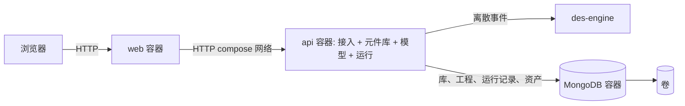
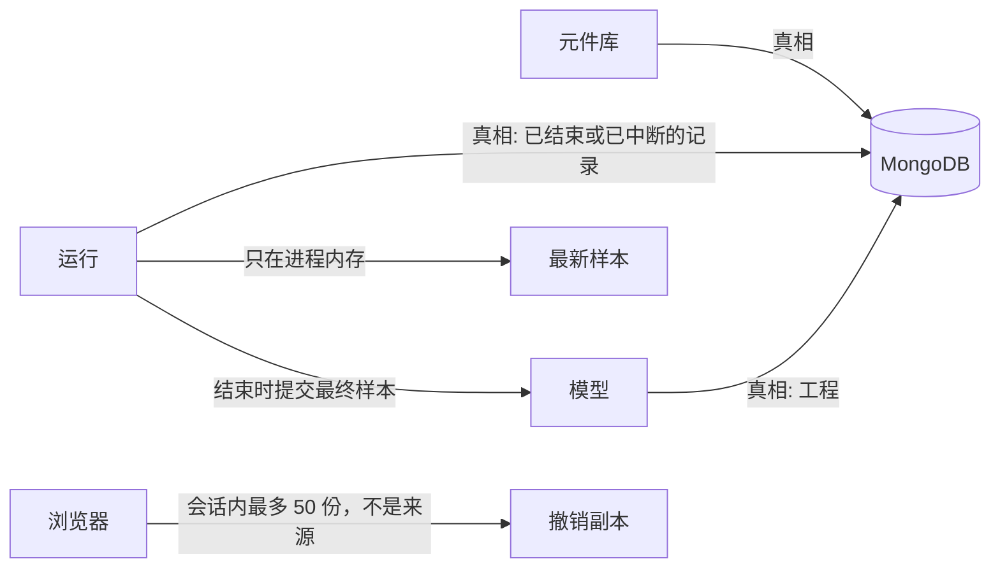
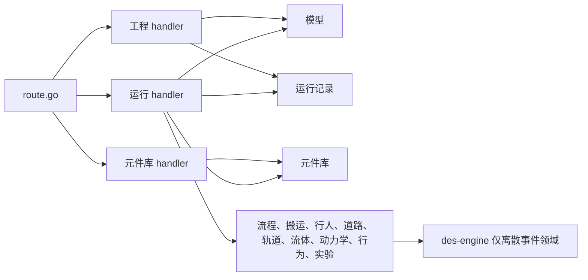
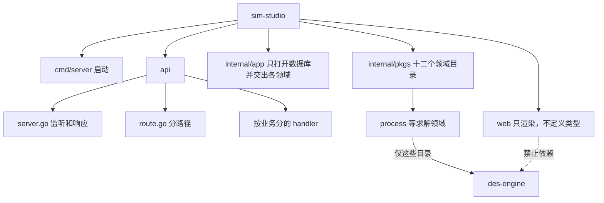
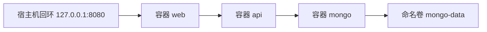

# Sim Studio 框架设计

## 1. 简介

### 1.1 目的

这份文件重定 Sim Studio 的骨架。上一轮把「文档」和「运行」当成领域，又把元件种类、端口和属性模式留在页面里。那一轮因此答不出：模块从哪来、连线和属性归谁、智能体存在哪、官网列出的几组能力各由谁计算。本轮改边界和数据所有权。模块的输入输出和出错条文写在 `docs/概要设计说明书.md`。

### 1.2 范围

单个系统，一台机器上的一个建模工作台。人在浏览器里建工程。工程里可以同时有离散事件流程、智能体、系统动力学、行业库里的元件、GIS 几何、动画对象和实验。des-engine 只提供离散事件时钟，不是这套能力的全部。

数据来源和持久存储都在后端。浏览器可以持有正在编辑的副本和本次会话的撤销栈，这两样都不是来源，刷新之后以数据库里的内容为准。

不在本轮：多用户、账号、Kubernetes、把 des-engine 改成网络服务、修改 des-engine 的源码、在线地图瓦片、实时接入外部业务系统、语言模型助手、多机并行训练。

### 1.3 术语

| 术语 | 含义 |
| --- | --- |
| 元件库 | 产品自带的类型目录。一个类型有端口、属性模式、默认外观，以及它交给哪一种求解器。真相在后端 |
| 模型 | 人建的一个工程：智能体、放上去的元件实例、连线、属性值、几何、呈现对象、实验。真相在后端 |
| 智能体 | 模型里的一种行为定义，不是运行时的一辆车。它可以带流程图、状态图、存量流量，以及种群数量 |
| 实例 | 运行时按种群产生的一个个对象。位置和计数在样本里，不写回元件库 |
| 运行 | 一次实验从开始到结束。外壳在进程里协调一个或多个求解器 |
| 样本 | 给页面的一帧。离散事件计数、存量、位置可以出现在同一帧，但各自标明来源 |
| 外壳 | 运行模块里、des-engine 事件循环之外的协程。调速、采样、求解器之间交换数据只发生在这里 |
| des-engine | 独立的 Go 库。仿真时间是整数毫秒，事件循环只有一个协程。它不认识存量、行人、轨道、道路、地图和三维 |

### 1.4 参考资料

- des-engine `engine/doc.go`、`README.md`：处理函数不能做 IO，不能调用 `Stop`、`Wait`、`Pause`、`Resume`、`Checkpoint`。
- 官网公开的能力分组：多方法建模、动画与可视化、行业库、GIS、数字孪生、仿真与人工智能。站点拒绝了直接抓取，`#tab1`、`#tab2`、`#tab3`、`#tab6` 在公开文本里对应到这些分组中的若干项；`#tab7` 的标题没有读到，不在本文编造。
- 本仓库当前代码：`api/server.go`、`api/route.go`、`api/handlers` 下按业务分的目录，以及 `internal/pkgs` 下的元件库、模型、流程、搬运、行人、道路、轨道、流体、动力学、行为、实验、运行记录。领域包互不引用。

### 1.5 现状里保留和打破的边界

| 现状 | 处理 |
| --- | --- |
| `web/` 的画布、连线拖拽、多根连线、删除连线、添加模块不自动连线 | 保留交互。元件清单改由后端提供，页面不再自己带一份类型目录 |
| `web/src/catalog.js` 定义类型、端口、属性模式和默认值 | 打破。这是数据来源放在了浏览器 |
| `internal/pkgs/doc` 把工程正文和运行记录放在一个包里，并被叫做领域 | 打破。拆成元件库和模型两个上下文。运行记录归运行上下文 |
| `internal/pkgs/run` 用 des-engine 编译第一批流程元件，系统动力学另做积分，流程和存量同时出现就拒绝 | 打破「同时出现就拒绝」。des-engine 仍只编译离散事件元件。外壳负责把其他求解器的结果放进同一帧样本 |
| 页面通过 HTTP 保存和读取工程，MongoDB 由 `api` 连接 | 保留方向。元件库也走这条路径，不在浏览器里另存 |
| des-engine 作为库被 `api` 引用 | 保留。不复制、不修改、不单独做容器 |

## 2. 设计方案

### 2.1 干系人和质量场景

干系人是建模的人，以及在这台机器上用 Docker 把它拉起来的同一个人。

重要性高且难度高的是 S1、S2、S4、S8。S8 是本轮新的驱动：元件定义和工程内容都不能由页面充当来源。S6、S7 仍决定求解器留在哪，但不因此增加容器。

| 编号 | 场景 | 重要性 | 难度 |
| --- | --- | --- | --- |
| S1 | 来源是建模的人。刺激是对当前工程的 Simulation 点运行。环境是本机、正常交互，模型约 50 个元件（假设）。制品是这一次运行。响应是时钟走动，页面看到样本；队列满时运行不中断，多出来的到达在外面等。度量：点击后 500 ms 内看到第一帧；之后样本年龄的 95 分位不超过 200 ms；队列满不构成运行失败。停止时间为 480 模型分钟时，尽快模式在 30 秒墙钟内结束（假设，见 2.4） | 高 | 高 |
| S2 | 来源是 `api` 或 MongoDB 容器重启或崩溃。刺激发生在文档已经被数据库确认之后，或一次运行尚未结束时。环境是本机 Docker。制品是元件库、工程和已结束的运行记录。响应是重启后元件库和工程仍在；已结束的结果仍在；未结束的运行标成中断。度量：已确认文档零丢失；已结束结果零丢失；健康检查通过后 3 秒内页面能再次读到该工程和元件库 | 高 | 高 |
| S3 | 来源是维护者。刺激是只改页面，或只升级后端所依赖的 des-engine。环境是一次 `docker compose up`。制品是两个自建镜像和一个官方数据库镜像。响应是页面和后端互不重新编译对方。度量：自建镜像两个；数据库容器一个；改页面不执行 `go build`；不引入 Kubernetes | 高 | 中 |
| S4 | 来源是正在进行的运行。刺激是外壳要暂停、采样、改速度，或在求解器之间交换一帧。环境是引擎协程可能正处在处理函数里。制品是 des-engine 的事件循环。响应是调速、采样、HTTP、写数据库和读取其他求解器都不进入处理函数。度量：处理函数里对五个控制方法和网络、磁盘的调用次数为零 | 高 | 高 |
| S5 | 来源是建模的人。刺激是添加模块、拖出连线、删除连线、改属性、撤销。环境是编辑，本机。制品是工程。响应是提交整份工程，添加模块不产生连线，同一对模块可以有多根线，属性值随工程保存。度量：保存请求的 95 分位在 200 ms 内；撤销覆盖本次浏览器会话里最近 50 份工程 | 中 | 低 |
| S6 | 来源是建模的人。刺激是运行含有货位、路径、搬运车队的工程，并打开三维窗口。环境是本机，约 50 个元件、车队 10 辆（假设）。制品是这一次运行的样本和三维画面。响应是队列、旅行时间、车辆占用由运行模块计算；三维只画这份样本里的位置。度量：沿用 S1 的第一帧 500 ms 和样本年龄 200 ms；画面上正在移动的对象数等于样本里的对象数 | 高 | 高 |
| S7 | 来源是建模的人。刺激是一次运行里同时有流程队列和存量，或运行强化学习实验，或使用 GIS 路径。环境是本机、一次一个运行。制品是该次运行的样本。响应是外壳在处理函数之外交换两种结果；存量不标成 des-engine 的结果；强化学习按回合顺序重跑，一次一个回合；GIS 路径长度来自模型里的几何。度量：同一帧里队列计数的来源是 `engine`，存量的来源是 `dynamics`；回合结果的来源是 `engine`，奖励曲线的来源是 `experiment`；路径上的位置与该样本时刻相差不超过 200 ms | 高 | 高 |
| S8 | 来源是打开工作台或添加模块的人。刺激是页面需要元件清单、端口和属性模式，或刷新之后要看到已保存的智能体、连线和属性。环境是本机，数据库已有元件库和至少一个工程。制品是元件库和工程。响应是页面只渲染后端返回的类型和工程；浏览器里没有第二份类型目录。度量：清空站点数据后刷新，类型清单和已保存工程都还在；页面源码中不再出现类型目录的定义 | 高 | 高 |
| S9 | 来源是 `nitman118/AnyLogic-Models` 的 `master` 上 248 个模型里出现过的功能。刺激是要求这些功能能在本系统里摆上画布并跑出样本。环境是本机、一次一个运行。制品是功能项清单，共 103 项：80 种库元件，加上状态图、存量流量、事件、日程、表函数、短表达式、参数实验、顺序优化、种群、智能体连接、统计图、控件、三维摄像机、GIS 折线、模型内输入表、长 Java、外部 jar、Python、R、活的 Excel、外部数据库、地图检索、声音。响应是其中至少 83 项有确定的数据、求解规则和样本字段，实现后可以摆上并运行。度量：可运行项不少于 83，即不少于 80% | 高 | 高 |

关注点：

| 关注点 | 结论 |
| --- | --- |
| 功能与语言 | 元件库说类型、端口、属性模式、求解器种类。模型说智能体、实例、连线、属性值、几何、实验。运行说样本、速度、求解器。三套词不能放进同一个包。对应 S7、S8 |
| 数据 | 元件库、工程、已结束或已中断的运行记录在 MongoDB。二进制资产单独存放，不塞进工程正文。浏览器只有副本和会话撤销栈。进行中的样本只在 `api` 内存。对应 S2、S5、S8 |
| 通信 | 编辑和读取元件库都要在一次请求里知道成败，对应 S5、S8。运行要持续看到样本，完成可以晚于点击，对应 S1 |
| 失败与容量 | 一个用户、一次运行。`web` 坏了打不开页面。`api` 坏了，已确认的库和工程仍在 MongoDB。MongoDB 坏了，保存和读取类型都失败，页面不改用内置目录 |
| 安全 | 本轮没有登录。信任边界是宿主机回环：只把页面端口绑在 `127.0.0.1`。`api` 和 MongoDB 都不映射到宿主机 |
| 观测 | 要能看见样本年龄是否超过 200 ms，未结束运行是否在启动时被标成中断，以及页面是否又在本地定义类型 |
| 演进 | 最可能变的是行人、轨道、道路各自的数值方法，其次是资产文件格式。求解器仍在运行模块里，不因此加容器 |
| 团队与发布 | 一个人，两个镜像，对应 S3 |
| 成本 | 三个容器：两个自建镜像、一个官方数据库镜像、一个卷。不加消息中间件，不加地图服务 |
| 合规 | 不适用。没有监管、审计年限或地域限制 |

### 2.2 与外部的关系

外部只有两方。浏览器是人用的。des-engine 是必须服从的库，而且只覆盖离散事件。

对 des-engine 的关系是防腐层加遵奉：运行模块把流程图翻译成原子模型和耦合，再把计数翻译成样本。页面和模型都看不见 `Engine`、`Coordinator`。否决共享内核。否决各行其道：S1 要求人拖出来的线就是这次离散事件运行的耦合。

领域是下面这十二个，放在同一个 Go 进程里，包和包之间没有引用。`doc` 不是领域，它只是模型当时用错的目录名。运行记录也不是把流程、行人、流体都装进去的那个包。否决客户-供应商式的包引用：模型不去引用元件库的类型，求解领域不去读取工程包。类型标识只是字符串。谁要同时用到多个领域，由接入里的那一个业务 handler 组合。

### 2.3 选型标准

方案要同时满足 S1 的 200 ms 样本、S2 的零丢失、S3 的两个自建镜像、S4 的处理函数禁令、S8 的类型来源在后端。多一个始终在跑的中间件，或让每一毫秒跨一次进程，都算不满足。

### 2.4 假设

| 假设 | 拿它做了什么 | 推翻时作废 |
| --- | --- | --- |
| 一个用户，一次最多一个运行 | 不按租户拆分，进程内一次只有一组求解器 | 结构轴和部署轴 |
| 1× 定义为 1 模型毫秒对 1 墙钟毫秒，10× 是 10 模型毫秒对 1 墙钟毫秒 | 调速由外壳暂停和继续完成 | 运行模块的调速方式 |
| 尽快模式下，480 模型分钟、约 50 个元件，30 秒墙钟内结束 | 不为此加第二组求解器进程 | 达不到时先重开 S1 的度量 |
| 工程正文小于 2 MB；元件实例日常约 50、上限约 500 | 工程整份替换。图片、三维模型和 shapefile 不放进正文 | 数据轴 |
| 车队不超过 10，一次运行的实例不超过 200 | 位置逐个放进样本 | 超过则样本改成聚合计数，仍不增加容器 |
| GIS 路径长度就是模型里折线的坐标长度 | 不接地图瓦片和地名检索 | 若必须使用真实路网，重开数据来源；仍不把地图做成容器 |
| 没有资产文件时，三维用类型自带的默认外观 | 运行模块只给位置 | 选定文件格式时只改资产存放，不改求解器 |
| 刷新可以丢掉撤销栈 | 修订历史不进数据库 | 若要求跨刷新撤销，模型上下文要加历史 |
| 工作台只在本机回环使用 | 不设登录 | 若端口对局域网开放，安全决策作废 |
| 系统动力学的步长是 1 模型秒 | 外壳按这个步长积分 | 推翻时只改运行模块的步长 |
| 数字孪生本轮只吃模型里保存的一份输入快照，不接实时外部系统 | 不增加入口容器 | 若必须接实时数据，在 `api` 进程加一个入口，不新增容器 |

### 2.5 约束

- 前后端分开放，后端是 Go，前端的进程是 Node.js，用 Docker 拉起。
- 元件库、工程和运行记录必须进数据库，并随 `docker compose up` 一起拉起。数据库是 MongoDB 单节点容器。
- 页面不是类型、连线、属性、智能体的来源。
- des-engine 保持为库，不改它的仓库。
- 处理函数不能做 IO，不能调用 `Stop`、`Wait`、`Pause`、`Resume`、`Checkpoint`。
- 队列满不是运行失败。
- 添加模块不自动连线。两模块之间可以有多根连线，连线可以删除。
- 不使用 Kubernetes。不把 AnyLogic 的商标和图片复制进本系统。

### 2.6 备选方案

**部署和进程**

留下 `web`、`api` 两个应用容器，再加一个 MongoDB 容器。元件库、模型、运行和引擎调用都在 `api` 一个进程里。

否决一个容器里同时放页面和后端。S3 的「改页面不编译 Go」不成立。

否决按元件库、模型、运行拆成三个 Go 容器。S1 的采样和 S4 的暂停都要在引擎所在的进程里完成。S8 的类型检查也会变成每次保存都跨网络。

否决由 Node 保存工程或提供元件目录。那会把 S8 的来源放回浏览器或放进第二个进程。

**通信**

留下同步 HTTP。编辑和读取元件库在一次请求里结束。运行是一次同步命令，随后每 200 ms 查询最新样本。

否决消息队列。没有第二个消费者，S3 也不允许再加一个运行单元。

否决把 WebSocket 当成必须。S2 重启后连接会断；下一次查询拿到最新样本或「已中断」就能接上。

**数据**

留下 MongoDB 单节点。官方镜像，卷只挂给它，端口不映射到宿主机。`api` 在日志确认之后才对保存回答成功。进行中的样本不写入。单节点，不建副本集。

元件库、工程、运行记录是三组数据。图片和模型文件单独存放在同一个数据库里，用标识被工程引用，不放进那份小于 2 MB 的正文。

否决 MySQL 和 PostgreSQL。本系统按标识整份读取工程，不按连线做关系查询。

否决 SQLite。它不是 Compose 拉起的数据库服务。见 ADR-5，已被 ADR-6 取代。

否决页面内置元件目录，只把人填的属性值交给后端。类型、端口和属性模式本身就是数据来源，S8 失败。

否决事件溯源。要留的是当前工程和已结束的样本，不是每一次拖动。

**调速**

留下交互运行用 `WithRealtime(false)` 创建离散事件引擎。1× 和 10× 由外壳按比例调用 `Pause` 和 `Resume`。尽快模式不因为追墙钟而暂停。改速度不重建求解器。

否决为了 10× 换一台引擎。实时模式创建后不能改，换引擎会丢掉这次运行的内存状态。

**离散事件怎么接 des-engine**

留下流程图使用库的协调器，连线变成原子模型之间的耦合。

否决运行模块自己排事件、把连线留在库外面。S1 要求人拖出来的线就是这次离散事件的结构。若某类流程元件无法写成原子模型，这条作废，部署轴不动。

**多种方法怎么放**

留下全部求解器都在运行模块里，由外壳在处理函数之外交换同一帧。离散事件使用 des-engine。系统动力学是定步长积分。智能体的状态图由外壳推进，种群里的每个实例有自己的状态；实例若走进流程图，才成为协调器上的原子模型。流体由外壳按网络积分，在边界上转换成离散实体。行人、轨道、道路各有自己的空间步进，不放进 des-engine。GIS 不是求解器，几何在模型里。强化学习按回合顺序重跑，一次一个回合。三维不是求解器。

否决同一智能体里出现两种方法就拒绝运行。上一轮这样定，是为了不在处理函数里做第二套计算。外壳已经在处理函数外面，拒绝运行会让多方法模型无法工作，S7 的新度量达不到。

否决给动画、GIS、流体、行人、轨道、道路、强化学习各做一个容器。S3 的容器数已经定下。S6 要求画面上的对象数等于样本里的对象数。

否决把系统动力学或行人步进写进 des-engine 的处理函数。库按事件跳过空毫秒，也不提供空间相互作用。改库违反约束。

否决外接地图服务。路径长度来自模型。再加一个服务就多一个失败域，也超出本机回环。

否决把数字孪生做成实时接入 ERP 或设备。本轮没有这条场景。模型里的一份输入快照已经能让同一次运行按外部给定的初值重放。

### 2.7 选定的技术

| 单元 | 选定 |
| --- | --- |
| `web` | Node.js 22。构建物是现有的 Vite 和 React 18 页面。进程只发页面和代理 `/api`。不携带元件目录 |
| `api` | Go 1.25。标准库 HTTP。依赖 `github.com/cgcodeboy/des-engine`，用官方 Go 驱动访问 MongoDB |
| 拉起 | Docker Compose。三个服务。命名卷只挂在 MongoDB。宿主机只发布 `127.0.0.1:8080` 到 `web` |
| 数据库 | MongoDB 7。元件库、工程、运行记录、资产。单节点，日志确认后返回 |

### 2.8 官网那几组能力各自归谁

这些是能力归宿，不是把对方的界面或图片搬过来。

| 公开能力 | 数据在哪 | 谁计算 | 本轮明确不做 |
| --- | --- | --- | --- |
| 多方法：离散事件、智能体、系统动力学，以及流程图、状态图、存量流量 | 智能体的各部分都在工程里 | 外壳按部分选择求解器，在处理函数外合成一帧 | 不把三种方法写进 des-engine |
| 动画与可视化：二维、三维、图形对象、控件、仪表、导入的图和模型 | 呈现对象和资产在后端；样本给位置 | 页面只画。运行模块不算碰撞 | 不用画面里的物理引擎调度车辆 |
| 行业库：流程、流体、轨道、行人、道路、物料搬运 | 类型和属性模式在元件库；实例和属性值在工程 | 流程和物料搬运的排队、占用用 des-engine。流体、行人、轨道、道路用运行模块里对应的步进。搬运的旅行时间用路径长度除以速度 | 不复制对方的元件实现 |
| GIS：点、路径、区域，沿路径移动 | 几何在工程里 | 运行模块读取长度和坐标，把位置放进样本 | 不做地名检索，不拉地图瓦片 |
| 数字孪生：用外部状态试决策 | 实验上的一份输入快照在工程里 | 运行模块用这份快照当初值 | 不接实时外部系统，不做云端托管 |
| 仿真与人工智能：强化学习、把训练好的模型放进仿真、导出样本 | 实验定义和策略文件在后端。策略在运行开始前读入内存 | 强化学习顺序重跑求解器。决策元件只读已经在内存里的策略 | 不做语言模型助手，不做多机并行训练 |

### 2.9 一组公开模型里实际用到的功能

仓库 `nitman118/AnyLogic-Models`（`master`，248 个 `.alp`）被用来核对上一节是不是空话。统计的是每个模型里出现过的库元件类型，不是连线端口上的重复引用。

当前代码里语义算得对的库元件只有 `Source`、`Sink`、`Delay`、`Queue`。`Seize`、`Release`、`Service`、`Convey`、`MoveByTransporter`、`Store`、`Retrieve` 只是一段固定延时或零延时，不算实现了对应功能。

| 度量 | 结果 |
| --- | --- |
| 模型数 | 248 |
| 用到行业库元件的模型 | 141 |
| 库元件类型 | 80 |
| 其中语义已实现 | 4（5%） |
| 这 141 个模型里，已实现类型占该模型类型集合的平均比例 | 35% |
| 该比例达到 50% 的模型 | 44 / 141 |
| 只用已实现类型就能跑的模型 | 6 / 141 |
| 含有状态图字样的模型 | 88 |
| 含有存量或流量的模型 | 49 / 47 |
| 含有非空代码的模型 | 247。其中只有短表达式的 138，少量长代码的 44，大量长代码的 65 |
| 参数实验 / 优化实验 | 22 / 20 |
| 日程、GIS 图元、Excel | 33 / 12 / 12 |

按「库元件类型的一半」或「每个模型里一半类型能算对」都不达到 50%。下面按机制设计补齐。仍然做不到的单列在本节末尾，不伪装成已经有求解器。

**流程控制，仍用 des-engine。** `SelectOutput`、`SelectOutput5`、`Hold`、`Wait`、`Enter`、`Exit`、`PlainTransfer`、`Split`、`Combine`、`Batch`、`Unbatch`、`Pickup`、`Dropoff`、`Assembler`、`RestrictedAreaStart`、`RestrictedAreaEnd`、`TimeMeasureStart`、`TimeMeasureEnd` 各写成一个原子模型。条件、延时、批量用表达式，不用 Java。`Enter`/`Exit` 是跨智能体的端口。时间测量只在样本里记通过时刻。限制区是一段容量有限的路径，容量在内存里，处理函数不写盘。

**资源。** `ResourcePool` 是内存里的一组空闲单元。`Seize` 在没有单元时不输出；`Release` 归还并唤醒等待者。`Service` 是占用、延时、归还。`ResourceSendTo`、`ResourceTaskStart`、`ResourceTaskEnd`、`ResourceAttach`、`ResourceDetach` 是同一组单元的移动和附带，旅行时间用路径长度除以速度。单元的位置写进样本。

**物料搬运。** 传送带描述符（路径、站台、转台、分流）是模型里的几何，不是求解器。实体在 `Conveyor`、`Convey`、`ConveyorEnter` 上的停留时间等于沿折线的长度除以速度。`MoveByTransporter`、`SeizeTransporter`、`ReleaseTransporter`、`TransporterFleet`、`TransporterControl` 使用车队容量和路网，不再使用固定 1 秒。`RackStore`、`RackPick`、`RackSystem` 是带货位地址的存储，满了就等待，不等同于队列外溢出。

**行人、道路、轨道、流体。** 前两者不能写进 des-engine。行人用外壳按 0.1 模型秒步进：每个行人有目标点和期望速度，与邻近行人保持间距；墙来自模型里的折线。道路用同一外壳：一车道上的后车速度受前车间距限制。轨道改用离散事件：股道是按长度占用的资源，列车通过时间是距离除以速度，道岔同时只允许一列。流体用外壳对罐的液位做定步长积分，阀门决定流量，`FluidSplit` 和 `FluidSelectOutput` 在外壳上分流，`ProcessTank` 在边界把流体换成离散实体。这四类和流程同时存在时，交换仍发生在处理函数之外，沿用 S4。

**状态图、事件、日程、表函数。** 状态图由外壳解释：超时、条件、消息、速率触发迁移；进入和离开动作只允许表达式。事件是定时或条件。日程是模型时间上的分段取值，资源和到达速率可以引用它。表函数按表插值。数组维度只出现在 3 个模型里：存量可以是一组下标，每个下标一条积分。

**实验。** 参数实验和优化都不另起进程，也不并行。参数实验按给定范围逐次重跑。优化每次只跑一轮，目标是样本里的一个数（通过时间或成本），用坐标搜索，最多 30 轮（假设）。强化学习仍是逐回合重跑。

**短表达式。** 138 个模型的代码都不长。属性、条件和延时用同一套表达式：数、参数、均匀、指数、三角、正态、模型时间、本智能体的变量。不提供类、导入和循环。

**图、控件、三维。** 时间图和柱状图读样本历史，由页面画。按钮和滑块在暂停时改参数，下一次继续使用新值。摄像机和灯光是呈现对象，不参与计算。

**智能体种群。** 种群数量在智能体上。每个实例有自己的状态图和位置。离散空间按格更新，连续空间按速度更新。实例进入流程图时才成为 des-engine 上的实体。智能体之间的连接是实例图，消息由外壳投递。

S9 的 103 项里，下面 95 项设计为可搭建并运行，占 92%。算法在 `docs/详细设计说明书.md` 的程序 `RUN`。另外 7 项不运行：长 Java、外部 jar、Python、R、活的 Excel、外部数据库、地图检索。声音不产生样本，模型里若只有声音而不影响流程，运行仍可进行，声音不播放。它不计入 95 项。

可运行的 80 种库元件是：`Source`、`Sink`、`Delay`、`Queue`、`MoveTo`、`Seize`、`Release`、`Service`、`ResourcePool`、`ResourceSendTo`、`ResourceTaskStart`、`ResourceTaskEnd`、`ResourceAttach`、`ResourceDetach`、`SelectOutput`、`SelectOutput5`、`SelectOutputIn`、`SelectOutputOut`、`Hold`、`Wait`、`Enter`、`Exit`、`PlainTransfer`、`Split`、`Combine`、`Batch`、`Unbatch`、`Pickup`、`Dropoff`、`Assembler`、`RestrictedAreaStart`、`RestrictedAreaEnd`、`TimeMeasureStart`、`TimeMeasureEnd`、`PMLSettings`、`Convey`、`Conveyor`、`ConveyorEnter`、`ConveyorPathDescriptor`、`PositionOnConveyorDescriptor`、`ConveyorSimpleStationDescriptor`、`ConveyorTransferTableDescriptor`、`ConveyorTurntableDescriptor`、`ConveyorTurnStationDescriptor`、`MoveByTransporter`、`SeizeTransporter`、`ReleaseTransporter`、`TransporterFleet`、`TransporterControl`、`RackStore`、`RackPick`、`RackSystem`、`MHLSettings`、`PedSource`、`PedEnter`、`PedGoTo`、`PedWait`、`PedService`、`PedSelectOutput`、`PedExit`、`PedSink`、`PedGroupAssemble`、`PedGroupDisassemble`、`PedAreaDescriptor`、`PedSettings`、`CarSource`、`CarEnter`、`CarMoveTo`、`CarExit`、`CarDispose`、`TrainSource`、`TrainMoveTo`、`TrainDispose`、`FluidSource`、`Tank`、`Valve`、`ProcessTank`、`FluidSplit`、`FluidSelectOutput`、`FluidDispose`。

另外 15 项也可运行：状态图、存量流量、事件、日程、表函数、短表达式、参数实验、顺序优化、种群、智能体连接、统计图、控件、三维摄像机、GIS 折线、模型内输入表。模型内输入表是人保存在工程里的表，不是外部数据库。

仍然做不到，模型里出现下列构造时，这次运行返回 `invalid`，不产生另一套数：

| 功能 | 为什么不做 |
| --- | --- |
| 长 Java、新建类、导入、AnyLogic 的 Java API | 要在进程里放一个 Java 运行时。65 个模型有大量长代码，44 个有少量长代码。短表达式以外的代码拒绝 |
| 外部 jar | 不受本系统控制的二进制 |
| 模型里调用 Python 或 R | 多一个语言运行时 |
| 运行中打开活的 Excel，或连接外部数据库 | 超出本机回环。工程里的输入表可以读 |
| 地图检索和瓦片 | 不增加地图服务。沿折线移动可以跑 |

声音不播放。它不改变样本，所以不从这 103 项里扣。对方优化器的内部算法不复现；顺序坐标搜索算作「顺序优化」这一项，因此计入可运行。行人用期望速度加间距，计入 `PedGoTo`，不声称与对方逐帧相同。

## 3. 系统架构

### 3.1 边界

领域按职责切开，一个领域一个目录，都在 `internal/pkgs` 下面。领域的包不引用另一个领域的包。没有 `common`、`shared`、`doc` 这种横跨领域的包。des-engine 是外部库，只有离散事件领域引用它，这不是领域之间的耦合。

页面不是领域。接入也不是领域。接入按业务拆 handler：一个业务一件事，这件事里可以调用多个领域。handler 之间不互相调用。

| 领域 | 目录 | 拥有 | 堆在 `run` 里的文件归这里 |
| --- | --- | --- | --- |
| 元件库 | `library` | 类型、端口、属性模式、默认外观、求解器种类 | 类型清单。不是 `compile.go` |
| 模型 | `model` | 工程、智能体、连线、属性值、几何、实验定义、种群数量 | 现在的 `doc`。种群数量是工程上的数 |
| 流程 | `process` | 流程图上的离散事件规则 | `flow.go`、`batch.go`、`measure.go`、`resource.go` |
| 搬运 | `handling` | 传送带、车队、货架 | `conveyor.go`、`fleet.go`、`rack.go`、`settings.go` 里的搬运设置 |
| 行人 | `pedestrian` | 行人步进和间距 | `pedestrian.go` |
| 道路 | `road` | 跟车间距 | `road.go` |
| 轨道 | `rail` | 股道占用 | `rail.go` |
| 流体 | `fluid` | 液位和流量 | `fluid.go` |
| 动力学 | `dynamics` | 存量、流量、动态变量 | `dynamics.go` |
| 行为 | `behavior` | 状态图、事件、日程、表、短表达式 | `statechart.go`、`event.go`、`schedule.go`、`table.go`、`expr.go` |
| 实验 | `experiment` | 参数轮次和坐标搜索 | `experiment.go` |
| 运行记录 | `record` | 一条记录的状态、速度、活动槽、最终样本 | `record.go`、`sample.go`、`repo`。不包含上面任何求解文件 |

旅行时间不单独立领域，也不抽公共包。用到长度的领域在自己的目录里计算。GIS 折线的点留在模型里，handler 把算好的长度交给对应领域。

### 3.2 四轴

结构轴留下一个模块化的 Go 进程，加上一个单独发布的 Node 页面进程。Go 里面是接入和上表的领域。依赖只允许从 handler 指向领域。领域不指向 handler，也不指向另一个领域。离散事件领域可以指向 des-engine。领域不依赖 HTTP。

否决微服务，对应 S1、S2、S4、S8。否决把类型模式和人填的属性值放进同一组类型：两者变化频率不同。

通信轴留下同步 HTTP，运行命令另加状态查询。进程内部是函数调用。否决理由见 2.6。

数据轴留下三个上下文各拥有自己的数据，都落在同一个 MongoDB 里。一次保存只替换一个工程，并等到日志确认。元件库的替换不和工程绑成一个事务。进行中的样本不落盘。跨到页面的一致性窗口就是样本年龄 200 ms。否决把每一帧写入数据库。

部署轴留下同一台宿主机上的三个容器。`web` 没有业务数据。`api` 重启不丢已确认的元件库、工程和结果。MongoDB 不可用时，读取类型和保存都失败，页面不改用内置目录。否决编排平台。否决按求解器再拆容器。

风格没有覆盖的轴：模块化进程不是通信方式，同步 HTTP 也不是数据所有权。上面四条要同时成立。

### 3.3 逻辑架构

谁依赖谁：

```text
浏览器 → web（Node） → api
  route.go 按路径分到一个 handler
  工程 handler → 模型，保存前向运行问是否还有活动记录
  元件库 handler → 元件库
  运行 handler → 运行、模型、元件库，以及这次工程用到的求解领域
领域包之间没有箭头。
```

系统外有谁，责任停在哪（上下文）：


信任边界画在浏览器到宿主机之间。发布出来的只有 `web` 的回环端口。des-engine 不在网络上。

哪些单元会独立失败（容器）：



数据谁拥有（信息）：



浏览器上的工程和类型清单都是副本。MongoDB 不可用时，页面停止添加模块，不改读打包在前端里的目录。

`api` 内部谁负责最难的变化（组件，只展开这一个容器）：



代码放在哪（开发）：



`internal/pkgs/doc` 改名为 `model`。求解文件从 `run` 拆到上表的目录。`web/src/catalog.js` 不再作为类型来源。

### 3.4 物理架构

一个 Docker 宿主机。三个容器在同一个 Compose 网络。命名卷只出现在 MongoDB。宿主机端口映射是 `127.0.0.1:8080 -> web:8080`。`api` 和 MongoDB 的端口都不映射。



不画多地域。没有边缘节点。

### 3.5 功能分解

| 模块 | 责任 |
| --- | --- |
| 页面服务 | 发出页面，把 `/api` 原样代理到 `api`。不保存工程，不计算样本，不定义元件类型 |
| 接入 | `server.go` 负责监听、读写响应。`route.go` 把路径分到一个 handler。工程、元件库、运行各是一个 handler 文件。handler 组合领域，领域不组合 handler |
| 元件库 | 拥有类型、端口、属性模式、默认外观、求解器种类 |
| 模型 | 拥有工程：智能体、元件实例、连线、属性值、几何、呈现对象、实验、资产引用。保存时整份替换。不查询运行记录 |
| 求解领域 | 流程、搬运、行人、道路、轨道、流体、动力学、行为、实验。各自计算自己的规则，不读取别人的包 |
| 运行记录 | 只拥有一条记录的状态、速度、活动槽和最终样本。不编译元件 |

采用的模式：

- 创建族没有这类问题。求解器种类由元件库的数据决定，不是一套必须同时 new 出来的产品族。
- 结构拆分用防腐层把 des-engine 挡在运行模块里，用接入把 HTTP 挡在三个上下文外面。放弃桥接。
- 行为上，一次运行使用状态：空闲、运行、暂停、结束、中断。求解器是可替换策略。放弃用观察者跨进程通知页面。
- 领域上，聚合有三个：一套元件库、一个工程、一条运行记录。一次写入不跨两个聚合。放弃把「保存工程」和「编译到引擎」写成同一段过程。
- 数据访问上，工程用修订号拒绝过期写入。放弃跨集合事务。放弃悲观锁。
- 集成与弹性：通信轴不是消息，点对点、发布订阅、死信整组不适用。外壳是隔舱。放弃熔断把进程内的引擎调用断开。
- 演进上，页面里的类型目录被元件库替换。这是按 S8 替换来源，不是两份目录并存。

### 3.6 场景走查

| 场景 | 路径上的元素 | 出现在哪张图 | 响应度量是否仍成立 |
| --- | --- | --- | --- |
| S1 | 浏览器、web、接入、运行、模型、元件库、des-engine、内存样本。队列满只改样本。外壳调 Pause 或 Resume | 容器图、组件图 | 成立的条件是代理不把查询缓冲成慢响应，且处理函数不写盘 |
| S2 | 日志确认后的元件库、工程和运行记录；api 启动时把未结束运行改成中断 | 容器图、数据所有权图、部署图 | 成立。若页面在数据库不可用时改读内置目录，S2 和 S8 一起失败 |
| S3 | web 镜像与 api 镜像分开构建；MongoDB 用官方镜像；卷只挂在数据库容器 | 部署图、开发视图 | 成立 |
| S4 | 外壳协程调用暂停、继续、停止、快照，并读取其他求解器的结果。处理函数只改本帧的离散事件状态 | 组件图 | 成立。处理函数访问数据库、HTTP 或其他求解器，即失败 |
| S5 | 浏览器提交整份工程和修订号；模型模块替换该工程；属性值和连线在这份工程里 | 数据所有权图 | 成立。撤销超过本次会话即丢失，这是假设 |
| S6 | 运行读取模型里的路径和货位，des-engine 计算队列和占用，样本带位置，页面只画 | 组件图 | 成立。画面另算一套位置即失败 |
| S7 | 外壳同时持有离散事件结果和积分结果，来源分开。GIS 几何留在模型。强化学习每个回合经过求解器 | 组件图、数据所有权图 | 成立。存量被标成 `engine`，或为 GIS 增加地图容器，即失败 |
| S8 | 浏览器向接入要元件库；接入读元件库；刷新后的智能体、连线、属性从模型读出 | 数据所有权图、开发视图 | 成立。`web/src/catalog.js` 仍定义类型，即失败 |

未画 C4 的代码级视图。4+1 的场景不另画一张图，走查就是上表。进程视图放在概要设计的处理流程。

### 3.7 决策记录

**ADR-1 两个容器，领域留在一个 Go 进程**

- 状态：已接受
- 上下文：S3；S1、S2、S4、S8
- 方案：两个应用容器，Go 内聚；一个容器；按上下文拆成多个 Go 服务
- 结果：`web` 与 `api` 两个应用容器。数据库容器见 ADR-6
- 后果：S3 变容易。变难的是 `web` 停了页面就不可用
- 证伪：改一处页面必须重新编译带 des-engine 的镜像；或一次采样跨了容器

**ADR-2 卷上的当前文档是真相，样本不落盘**

- 状态：被取代
- 上下文：S2、S5
- 方案：JSON 卷；数据库容器；浏览器本地存储
- 结果：存储形式被 ADR-6 取代。仍成立的是：真相不在浏览器，进行中的样本不落盘
- 后果：已写入文档可以在容器重建后还在。刷新后撤销丢失
- 证伪：出现两个都能写入的文档主人

**ADR-3 同步 HTTP 查询样本，外壳协程调速**

- 状态：已接受
- 上下文：S1、S4
- 方案：HTTP 查询加外壳调速；WebSocket；按速度重建引擎
- 结果：`WithRealtime(false)`，外壳调速，页面每 200 ms 查询一次
- 后果：S4 变容易。查询变慢时没有推送可以补偿
- 证伪：本机查询 95 分位超过 50 ms；或处理函数里调用 `Pause`

**ADR-4 流程图运行使用协调器和耦合**

- 状态：已接受
- 上下文：S1
- 方案：协调器加原子模型；运行模块直接排事件
- 结果：离散事件流程图使用协调器。其他方法不走这条
- 后果：多根连线有一处对应的库概念。变难的是无法写成原子模型的流程元件会让这次运行失败，而不是退回示意
- 证伪：一个要运行的流程元件无法在不违反处理函数禁令的前提下写成原子模型

**ADR-5 用 SQLite，不另起数据库容器**

- 状态：被取代
- 上下文：当时把数据库理解成不能多一个容器
- 方案：SQLite；PostgreSQL 或 MySQL；JSON 文件
- 结果：被 ADR-6 取代
- 后果：库文件跟 `api` 绑在一起
- 证伪：已经发生，数据库必须由 Compose 拉起

**ADR-6 用 MongoDB 单节点，由 Compose 拉起**

- 状态：已接受
- 上下文：S2、S5、S8
- 方案：MongoDB 单节点；MySQL 或 PostgreSQL；SQLite
- 结果：MongoDB。元件库、工程、运行记录和资产都在这里。端口不映射到宿主机
- 后果：S2 落在数据库的卷上。变难的是数据库不可用时，类型清单也读不出来
- 证伪：一次保存的 95 分位因为数据库超过 200 ms；或保存回答成功时日志尚未确认

**ADR-7 求解器留在运行模块，三维只画位置**

- 状态：被取代
- 上下文：S6、S7 的上一轮写法
- 方案：求解器都在运行模块；每种方法一个容器；同一智能体混用两种方法就拒绝
- 结果：求解器仍在运行模块、三维仍只画位置。这两点由 ADR-9 保留。拒绝混用被 ADR-9 推翻，因为外壳可以在处理函数之外交换结果
- 后果：上一轮让多方法模型无法运行
- 证伪：已经发生。含有队列和存量的工程被直接拒绝

**ADR-8 元件库和模型分开，类型来源在后端**

- 状态：已接受
- 上下文：S8。现状是 `web/src/catalog.js` 定义类型，`internal/pkgs/doc` 只保存人提交的整份 JSON
- 方案：后端元件库拥有类型、端口和属性模式，模型拥有实例、连线和属性值；继续由页面定义类型，后端只存一份不解释的 JSON
- 结果：三个上下文是元件库、模型、运行。页面只渲染后端返回的类型
- 后果：S8 变容易。变难的是数据库不可用时，页面不能离线添加模块
- 证伪：清空站点数据并刷新后类型消失；或页面源码里仍定义端口和属性模式

**ADR-9 外壳协调多种方法，des-engine 只做离散事件**

- 状态：已接受
- 上下文：S4、S6、S7。des-engine 没有存量、行人、轨道、道路和地图
- 方案：外壳在处理函数外交换多种求解器的同一帧；混用就拒绝；每种方法一个容器
- 结果：留在一个进程的运行模块里。离散事件进 des-engine。其余求解器由外壳步进。同一帧里的数字按来源标注
- 后果：S7 的多方法模型可以运行。变难的是外壳必须在采样前把各求解器的结果收齐，收不齐就不能把存量标成 `engine`
- 证伪：处理函数里出现对其他求解器或数据库的调用；或画面上的对象数和样本不一致

**ADR-10 按公开模型补齐机制，不引入第二种语言运行时**

- 状态：已接受
- 上下文：2.9。248 个模型里，语义已实现的库元件是 4/80，低于 50%
- 方案：在现有运行模块里补原子模型、资源、传送带、车队、行人步进、道路步进、轨道占用、流体积分、状态图、表达式、顺序参数实验和坐标搜索；或者嵌入 Java 并逐个兼容他们的 API
- 结果：留下第一方案。长 Java、外部 jar、Python、R、活的 Excel、外部数据库、地图检索、声音不实现
- 后果：只用短表达式和库元件的模型有了计算路径。变难的是 65 个带大量长代码的模型会被拒绝，而不是跑出另一套数
- 证伪：可运行项少于 83。当前计数是 95/103。或处理函数里出现表达式解释器之外的文件访问。

**ADR-11 领域互不引用，业务在 handler 里组合**

- 状态：已接受。取代 3.2 里「运行指向元件库和模型、模型指向元件库」的包依赖
- 上下文：领域被写成 `doc` 和 `run` 两个目录，求解文件都堆在 `run`，包之间互相引用
- 方案：十二个领域目录，零交叉引用，handler 组合；维持三个包并且让运行去读模型
- 结果：采用十二个目录。`api/server.go` 与 `api/route.go` 分开。业务目录是 `api/handlers/library`、`api/handlers/project`、`api/handlers/simulation`
- 后果：保存工程时，活动运行的检查发生在工程 handler，而不是模型包里。变难的是同一条规则不能再 import 别的领域来复用
- 证伪：任一领域目录的 import 出现另一个 `internal/pkgs/` 领域；或 `record` 目录里仍放着流程、行人、流体的规则

### 3.8 敏感点、取舍和证伪

- 敏感点：样本查询是否被代理缓冲；外壳是否在处理函数里暂停或读其他求解器；保存是否在日志确认之后才回答成功；数据库不可用时页面是否退回内置元件目录；一帧样本里存量是否被标成 `engine`。
- 取舍点：把运行拆到独立服务可以让页面和引擎分别扩容，但 S1、S4、S8 一起变差。把进行中样本写进数据库可以在崩溃后续跑，但 S2 要求的「未结束即中断」被取消。接上地图瓦片或实时外部系统可以更接近官网的 GIS 和数字孪生，但会多一个失败域，本轮没有这条场景。
- 风险：480 模型分钟在 30 秒内结束，以及行人、轨道、道路的步进能否在同一次运行里赶上 200 ms 的样本年龄，都还没测量。达不到时先重开度量，不先加容器。
- 非风险：求解器种类增加。只要仍由外壳在处理函数外选择，并且三维只读位置，就不要求新容器。
- 适应度：清空浏览器站点数据后刷新，元件类型和已保存工程仍能读到。一次同时含队列和存量的运行，样本里两种来源都在，且处理函数没有 IO。`docker compose restart api` 之后，已保存工程仍在，原先进行中的运行状态是中断。任意一条持续破线，重开 ADR-8 或 ADR-9。

开放项在概要设计的「尚未解决的问题」。`#tab7` 的标题没有读到，不进入本轮能力表。
