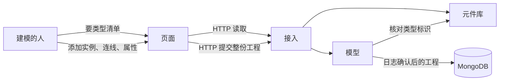
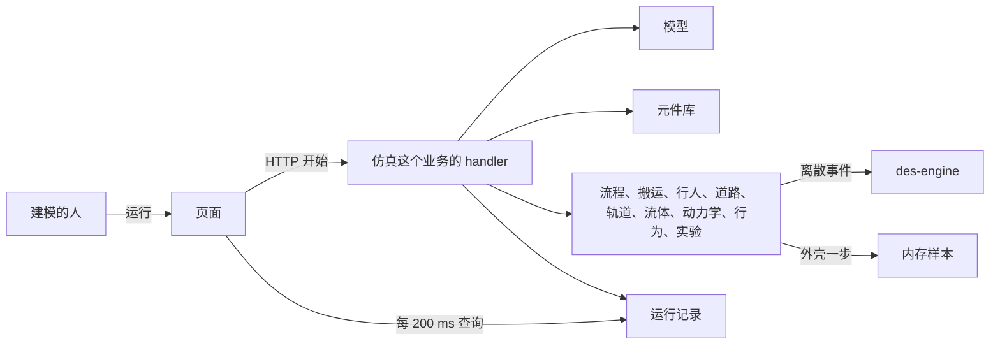

# 概要设计说明书

## 1 引言

### 1.1 编写目的

说明 Sim Studio 各模块做什么、模块之间传递什么、运行时怎样组合、数据落在哪、出错时系统如何回答。供把类型来源从页面移到后端、并把 `internal/pkgs/doc` 拆成元件库和模型时使用。

模块内部如何编译原子模型、修订号如何比较、外壳如何对齐多种求解器的一步，不写在这里。

### 1.2 背景

Sim Studio 跑在一台机器上。页面在 `web/`。离散事件时钟使用库 des-engine，不修改该库。元件类型、工程、智能体、连线、属性和实验结果的来源都在后端。框架见 `docs/框架设计.md`。

### 1.3 定义

框架设计 1.3 的术语在本文含义相同。另外：

| 术语 | 含义 |
| --- | --- |
| 修订号 | 工程上的整数。提交必须带上一次读到的修订号 |
| 来源 | 样本里一组数字的计算者。`engine` 是 des-engine，`dynamics` 是存量积分，`fluid`、`pedestrian`、`rail`、`road` 是对应的空间或流体步进，`experiment` 是多次运行汇总出的奖励或对比 |
| 外壳 | 运行模块中位于 des-engine 事件循环之外的协程 |
| 资产 | 图片、三维模型、shapefile。单独存放，工程里只留标识 |

### 1.4 参考资料

- `docs/框架设计.md`
- des-engine `engine/doc.go`、`README.md`
- GB/T 8567-1988 第 11 章的章节结构

## 2 总体设计

### 2.1 需求规定

主要输入是对元件库的读取、对工程的编辑，以及运行命令。主要输出是类型清单、保存后的工程、样本和运行状态。

| 输入 | 输出 | 性能 |
| --- | --- | --- |
| 打开工作台 | 元件库和工程列表 | 健康检查通过后 3 秒内能读到，对应 S2、S8 |
| 添加元件、连线、改属性、保存 | 确认后的工程 | 保存的 95 分位不超过 200 ms，对应 S5 |
| 对约 50 个元件的 Simulation 点运行 | 第一帧样本，其后持续样本 | 500 ms 内第一帧；样本年龄 95 分位不超过 200 ms，对应 S1 |
| 队列已满时继续到达 | 运行继续，样本里的队列外等待增加 | 不把队列满当成失败，对应 S1 |
| 同一工程里既有流程队列又有存量 | 同一帧里两组数字，来源分别是 `engine` 和 `dynamics` | 沿用 S1 的样本年龄，对应 S7 |
| 含路径和车队的运行，并打开三维 | 带位置的样本 | 画面上的对象数等于样本里的对象数，对应 S6 |
| `api` 或 MongoDB 重启 | 元件库和已确认工程仍在；未结束运行变为中断 | 已确认内容零丢失，对应 S2 |
| 只改页面后重新拉起 | 页面镜像单独更换 | 不因此执行 `go build`，对应 S3 |

带「假设」的数字与框架设计 2.4 相同。

### 2.2 运行环境

一台机器。Docker Compose 拉起三个容器：`web`（Node.js 22）、`api`（Go 1.25）、MongoDB 7。宿主机只把 `127.0.0.1:8080` 映射到 `web`。人使用本机浏览器。des-engine 不是容器，由 `api` 在进程内引用。

### 2.3 基本设计概念和处理流程

编辑和运行是两条路径。编辑不创建求解器。运行不修改元件库。

正常编辑（S5、S8）：

添加元件时，页面使用的端口和属性模式来自刚才读到的元件库。页面不补连线。

正常运行（S1、S6、S7）：

handler 把各领域的结果收成一帧。领域包不互相引用。离散事件的暂停和继续由这个业务在处理函数之外对 des-engine 调用。处理函数不读存量、不读地图、不写数据库。

故障（S2）：`api` 启动时把仍处于运行或暂停的记录改成中断，然后才接受健康检查。进行中的样本不恢复。

### 2.4 结构

| 模块 | 功能 | 控制关系 |
| --- | --- | --- |
| 页面服务 | 发页面，代理 `/api` | 不控制业务模块 |
| 接入 | `server.go` 监听，`route.go` 分路径，一个业务一个 handler | handler 可以调用多个领域。领域不调用 handler |
| 元件库 | 提供类型、端口、属性模式、默认外观、求解器种类 | 不调用其他领域 |
| 模型 | 保存和读取工程。工程内有智能体、实例、连线、属性值、几何、呈现对象、实验和资产引用 | 不调用其他领域 |
| 求解领域 | 流程、搬运、行人、道路、轨道、流体、动力学、行为、实验，各自一条规则 | 互不调用。离散事件领域可以调用 des-engine |
| 运行记录 | 一条记录的状态、速度、活动槽、最终样本 | 不调用其他领域 |

一次只有一个运行。新的开始会把上一个未结束的运行标成中断。

### 2.5 功能需求与程序的关系

| 功能 | 页面服务 | 接入 | 元件库 | 模型 | 仿真 |
| --- | --- | --- | --- | --- | --- |
| 类型、端口、属性模式 | 显示 | 接收 | 拥有 | 核对 | 选择求解器 |
| 智能体、实例、连线、属性值、几何、实验 | 编辑副本 | 接收 | | 拥有 | 读取 |
| 资产文件 | 显示 | 接收 | | 拥有引用 | 运行前读入内存 |
| 离散事件流程和物料搬运的排队、占用 | 显示样本 | 接收 | 标明求解器 | 提供连线 | 调用 des-engine |
| 选择输出、保持、等待、拆分、合并、批量、装配、限制区、时间测量 | 显示 | | 标明求解器 | 提供表达式 | 各为一个原子模型 |
| 资源池、占用、释放、服务、资源任务 | 显示位置 | | 标明求解器 | 提供容量和路径 | 内存中的资源单元，旅行时间用长度除以速度 |
| 传送带、转运车、货架 | 显示位置 | | 标明求解器 | 提供路径、站台和货位 | 停留时间用长度除以速度；货位满则等待 |
| 搬运旅行时间 | 显示位置 | | | 提供路径长度和速度 | 外壳换算后交给离散事件 |
| 系统动力学 | 显示存量 | | 标明求解器 | 提供存量和流量 | 外壳积分 |
| 状态图、事件、日程、表函数 | 显示状态 | | | 提供图和表 | 外壳解释；动作只允许表达式 |
| 智能体状态图和种群 | 显示实例 | | 标明求解器 | 提供状态图和数量 | 外壳推进；进入流程的实例才进 des-engine |
| 流体 | 显示 | | 标明求解器 | 提供网络 | 外壳积分，边界上交给离散事件 |
| 行人 | 显示位置 | | 标明求解器 | 提供墙和目标 | 外壳按 0.1 模型秒做期望速度和间距 |
| 道路 | 显示位置 | | 标明求解器 | 提供车道 | 外壳按前车间距限制速度 |
| 轨道 | 显示位置 | | 标明求解器 | 提供股道和道岔 | 股道按长度占用，离散事件 |
| GIS 沿路径移动 | 显示位置 | | | 拥有几何 | 外壳按长度计算位置 |
| 二维、三维、控件、仪表 | 绘制 | | 提供默认外观 | 拥有呈现对象 | 提供位置和计数 |
| 参数实验、优化 | 显示各轮结果 | 接收 | | 拥有取值范围和目标 | 顺序重跑；优化最多 30 轮坐标搜索 |
| 数字孪生的输入快照 | 编辑 | 接收 | | 拥有快照 | 当作初值 |
| 强化学习和策略 | 显示奖励 | 接收 | | 拥有实验和策略文件 | 顺序重跑，决策只读内存中的策略 |
| 已结束结果 | 查询 | 接收 | | | 拥有记录 |
| 会话内撤销 | 持有，不作为来源 | | | | |

MongoDB 不在这张表里。它不实现功能，只保存元件库、模型、运行写入的内容。

### 2.6 人工处理过程

人在页面上添加智能体、元件、连线和属性，并按下保存和运行。没有纸面流程，也没有第二个人审批。

元件库的初始内容由后端在数据库还没有库时写入。这不是人在页面上逐条创建类型。

### 2.7 尚未解决的问题

- 1× 是否严格等于 1 模型毫秒对 1 墙钟毫秒，尚未确认。
- 系统动力学步长暂按 1 模型秒。行人步进暂按 0.1 模型秒。
- 优化暂按最多 30 轮坐标搜索。若目标函数在这个预算内找不到可用参数，重开轮数，不增加进程。
- 资产文件用哪种三维和图形格式，还没选定。
- 策略文件的格式还没选定。运行开始前读入内存这一点已经定了。
- 官网 `#tab7` 的标题没有读到，不编能力名。
- 长 Java、外部 jar、模型内调用 Python 或 R、运行中读写 Excel 或外部数据库、地图检索、声音，见框架设计 2.9，本轮拒绝运行而不是另做一套结果。

## 3 接口设计

### 3.1 用户接口

人通过页面发出这些命令。系统的回答是成功后的数据，或第 6 章的错误。页面长什么样不在这里。

| 命令 | 系统回答 |
| --- | --- |
| 读取元件库 | 类型、端口、属性模式、默认外观、求解器种类 |
| 列出工程 | 每个工程的标识和名称 |
| 读取工程 | 智能体、实例、连线、属性值、几何、呈现对象、实验 |
| 保存工程 | 确认后的工程，修订号增加 |
| 删除工程 | 工程及其运行记录消失 |
| 上传资产 | 资产标识。工程保存时引用它 |
| 开始运行 | 运行标识、状态、第一帧样本 |
| 暂停、继续、停止、改速度 | 当前状态和最新样本 |
| 查询运行 | 状态和最新样本。已结束时样本是最终那一帧 |

### 3.2 外部接口

| 对方 | 传递 |
| --- | --- |
| 浏览器 | HTTP 到 `web`。页面和 `/api` 都从这里进入 |
| des-engine | 进程内函数调用。只有运行模块的离散事件部分使用。服从该库的处理函数禁令 |
| MongoDB | 由 `api` 通过 Compose 网络访问。日志确认后才回答保存成功 |
| Docker | Compose 拉起三个容器。卷只挂给 MongoDB |

没有地图服务，没有外部业务系统，没有消息中间件。

### 3.3 内部接口

| 从 | 到 | 传递 |
| --- | --- | --- |
| 工程 handler | 模型、运行记录 | 有活动运行就拒绝保存和删除。模型只改工程。删除后再删该工程的运行记录 |
| 元件库 handler | 元件库 | 读取类型清单 |
| 运行 handler | 模型、元件库、各求解领域、运行记录 | 先装求解，再写一条运行记录。求解失败不插入 |
| 流程、轨道、搬运 | des-engine | 离散事件元件和它们之间的耦合。由运行 handler 把原子模型交进去 |
| 行人、道路、流体、动力学、行为 | 运行 handler 持有的外壳 | 处理函数之外推进一步 |

领域之间没有包引用。运行记录不把样本写回元件库。元件库不读取工程。

## 4 运行设计

### 4.1 运行模块组合

| 使用方式 | 参与的模块 |
| --- | --- |
| 浏览和编辑 | 页面服务、接入、元件库、模型 |
| 一次实验运行 | 上面全部，再加上运行。离散事件部分再使用 des-engine |
| 只看已结束结果 | 页面服务、接入、运行。运行读取已经写下的记录 |
| 启动恢复 | 运行把未结束记录改成中断。不启动求解器 |

### 4.2 运行控制

- 编辑可以在没有运行时进行。该工程已有运行或暂停中的记录时，保存被拒绝，直到运行停止。
- 一次进程只有一个运行。开始新的运行时，上一个未结束的运行先标成中断。
- 速度是 1×、10×、尽快。改速度不重建求解器。
- 停止由人发出，或由实验的停止条件到达。崩溃和重启不把未结束运行接着跑，只标成中断。
- 强化学习按回合顺序执行。上一回合的最终样本写下之前，不开始下一回合。

### 4.3 运行时间

| 活动 | 占用 |
| --- | --- |
| 读取元件库和工程 | 一次 HTTP，目标在 200 ms 内 |
| 保存工程 | 一次 HTTP，等到数据库日志确认，目标在 200 ms 内 |
| 离散事件运行 | `api` 进程里的一个引擎协程，加上外壳协程 |
| 其他求解器 | 同一个 `api` 进程里的外壳，不另占容器 |
| 样本查询 | 每 200 ms 一次 HTTP，读内存。不占数据库 |
| 页面绘制 | 浏览器。不占求解器 |

尽快模式会占满一个 CPU 核直到运行结束或被停止。1× 和 10× 大部分时间停在外壳的等待上。

## 5 系统数据结构设计

只写数据集合、主要数据项和谁拥有。字段、键和索引不在这里展开。

### 5.1 逻辑结构

| 集合 | 主要数据项 | 关系 |
| --- | --- | --- |
| 元件库 | 类型标识、名称、所属库、端口、属性模式、默认外观、求解器种类 | 被工程里的实例引用。删除工程不删除类型 |
| 工程 | 标识、名称、修订号、智能体 | 一个工程包含多个智能体和多个实验 |
| 智能体 | 标识、名称、空间种类、种群数量、流程图上的实例和连线、状态图、存量流量、几何、呈现对象 | 属于一个工程。实例引用元件库的类型标识。连线引用本智能体里的实例 |
| 属性值 | 实例或实验上的一组值 | 必须能被该类型的属性模式解释。模式在元件库，值在工程 |
| 几何 | 点、折线、区域的坐标 | 属于智能体。运行只读长度和坐标 |
| 实验 | 标识、种类、停止条件、输入快照、策略资产标识 | 属于工程。种类包括普通仿真、对比和强化学习 |
| 资产 | 标识和文件内容 | 被呈现对象或策略引用。不属于元件库 |
| 运行记录 | 标识、所属工程、所属实验、状态、速度、最终样本 | 开始时创建，结束或中断时更新。不属于元件库 |

样本不是一个长期集合。进行中的样本只在运行模块的内存里。已结束的那一帧附在运行记录上。

### 5.2 物理结构

全部在 MongoDB 的一个库中，文件在只挂给数据库容器的卷上。`api` 是唯一的访问者。`web` 和浏览器不能连接数据库。

工程正文按整份替换。资产单独存放，避免把文件放进那份有大小上限的正文。进行中的样本不在卷上。

### 5.3 数据结构与程序的关系

| 集合 | 写入者 | 读取者 |
| --- | --- | --- |
| 元件库 | 元件库。数据库为空时由它写入初始内容 | 接入、模型、运行、经接入到达的页面 |
| 工程及其内部各项 | 模型 | 接入、运行、经接入到达的页面 |
| 资产 | 模型 | 模型、运行、经接入到达的页面 |
| 运行记录 | 运行 | 接入、经接入到达的页面 |
| 进行中的样本 | 运行，只在内存 | 接入、经接入到达的页面 |

页面可以在会话里保留最近 50 份工程副本用于撤销。那不是上表中的集合。

## 6 系统出错处理设计

### 6.1 出错信息

回答使用固定的错误类别，由接入变成 HTTP 状态。页面显示对应的一句说明。

| 类别 | 含义 | 谁回答 |
| --- | --- | --- |
| invalid | 工程引用了不存在的类型，连线两端不存在，或实验缺少停止条件 | 模型或运行 |
| notfound | 工程、类型、资产或运行记录不存在 | 对应的主人 |
| conflict | 修订号不是当前值 | 模型 |
| rejected | 该工程正在运行或暂停，不能保存；或命令对当前运行状态无效 | 模型或运行 |
| unavailable | 数据库不可用，或求解器没能启动 | 接入在无法归类时也用这一类 |

队列满不是错误。

### 6.2 补救措施

- 后备：MongoDB 的卷保留已确认的元件库、工程、资产和已结束结果。`api` 没有第二份库。
- 降效：数据库不可用时，保存和读取类型都失败。页面不改用内置目录，也不把浏览器副本写成新的真相。已打开的页面可以继续看着会话里的副本，但不能把它当成已保存。
- 恢复：`api` 启动时把未结束运行标成中断。不从内存样本接着跑。人可以再次开始。

### 6.3 系统维护设计

- 检测点：`/api/health` 在数据库可连接、且启动清扫已经做完之后才回答正常。
- 专用模块：启动清扫属于运行模块。它不启动求解器。
- 没有单独的维护界面。人通过容器的健康状态和页面上的错误类别判断。
