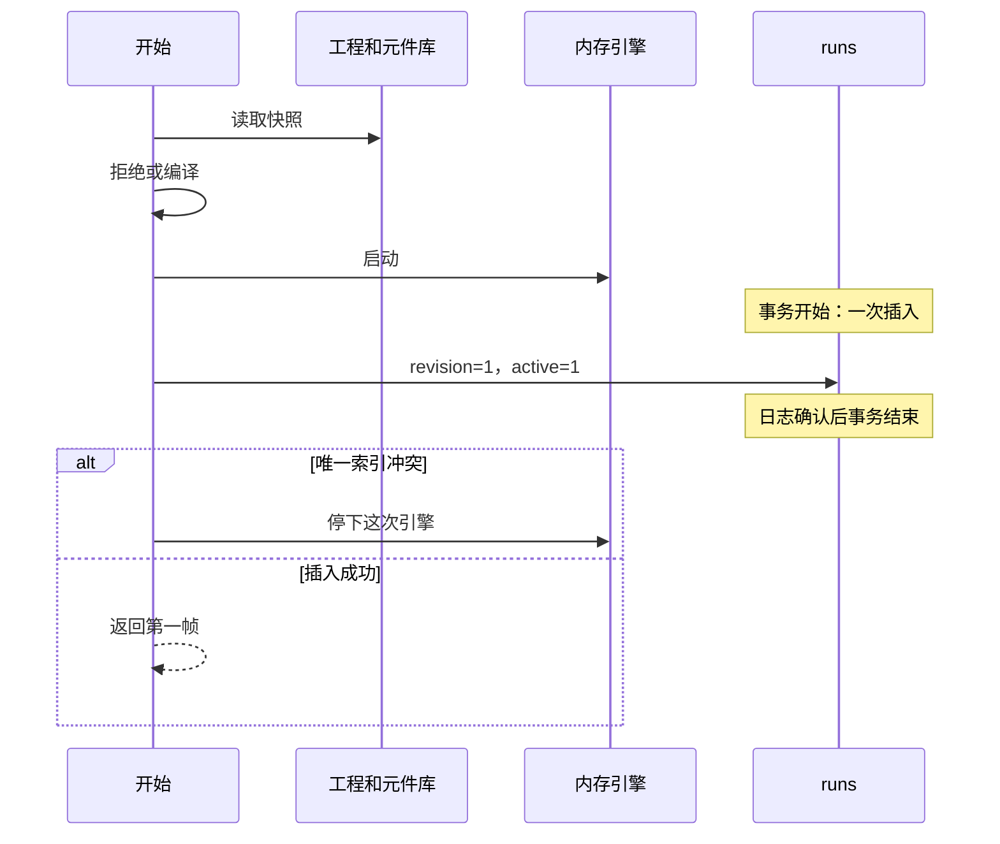

# 详细设计说明书

## 1 引言

### 1.1 编写目的

本文给实现程序 `RUN` 的人使用。写完应能按输入、错误、提交和文件落点写代码，不必再猜一次运行里哪些功能算、哪些直接拒绝。

### 1.2 背景

运行记录是框架里的一个界限上下文，代码落在 `internal/pkgs/record`。它和元件库、模型同在一个 Go 进程。本文不重选容器、数据库和通信。

### 1.3 定义

活动运行：状态为 `running` 或 `paused` 的运行记录。模型毫秒：des-engine 的整数时间。墙钟毫秒：操作系统时间。序列：样本里的一条命名数值，自带来源。

### 1.4 参考资料

- `docs/框架设计.md`
- `docs/概要设计说明书.md`
- Organizing a Go module，https://go.dev/doc/modules/layout
- Effective Go，https://go.dev/doc/effective_go
- Go Code Review Comments，https://go.dev/wiki/CodeReviewComments

## 2 程序系统的组织结构

本次只展开程序 `RUN`。元件库、模型、接入不是本程序。它们与 `RUN` 的契约写在第 3.8 节。

| 名称 | 标识符 | 层次 |
| --- | --- | --- |
| 运行 | RUN | 本进程内的界限上下文。上层是接入。下层是 `runs` 集合和 des-engine |

## 3 程序（RUN）设计说明

### 3.1 程序描述

`RUN` 把一次实验跑完，并守住「同时只有一条活动运行」。开始、暂停、继续、停止、改速度、结束、清扫是命令。取样本是查询。命令对 `runs` 的一次成功写入是一次日志确认的单文档更新，里面没有网络调用。引擎的事件循环在这次写入之外。程序可重入的范围只到请求号和版本：同一个请求号不第二次插入；同一个版本只有一个条件更新成功。

本程序负责的场景落点：

| 场景 | 本程序负责的那一段 |
| --- | --- |
| S1 | 编译、插入、返回第一帧；队列满只增加溢出计数。第一帧预算见 3.3 |
| S2 | 已结束样本留在 `runs`。进程重新接请求之前，把活动运行改成 `interrupted` |
| S4 | 处理函数不调用 Stop、Wait、Pause、Resume、Checkpoint，不访问网络和磁盘 |
| S6 | 位置只写进同一次样本 |
| S7 | 同一帧里队列序列的来源是 `engine`，存量序列的来源是 `dynamics` |
| S9 | 103 项里 95 项有求解规则和样本字段。另外 7 项返回 `invalid` 且不插入 |

非职责：页面如何画、工程正文如何提交、元件类型目录如何保存、要不要加容器。保存工程的 200 毫秒不属于本程序。

### 3.2 功能

开始：读入工程和元件库，拒绝不能跑的构造，在内存里编译并启动求解，再插入一条 `running` 记录，返回第一帧。

暂停、继续、停止、改速度：按版本条件更新这一条记录，并在处理函数之外拨动引擎。

取样本：活动运行读内存。已结束运行读 `runs` 里的最终样本。

结束：引擎空闲或实验轮次走完之后，把这一条改成 `finished` 并写下最终样本。

清扫：进程开始接请求之前，把活动运行改成 `interrupted`。丢掉悬挂记录是下一条命令，不放进同一次写入。

### 3.3 性能

沿用框架里的数。本程序分到的预算：

| 度量 | 本程序的预算 |
| --- | --- |
| S1 第一帧 500 毫秒 | 接入和两次快照读取占 150 毫秒。编译、引擎启动、一次插入、拼出第一帧占 350 毫秒 |
| S1 样本年龄 95 分位 200 毫秒 | 取样本读内存，预算 5 毫秒。200 毫秒的轮询在接入，不在本程序 |
| S1 尽快模式 480 模型分钟、约 50 个元件、30 秒墙钟 | 整个求解都在本程序。这仍是框架里的假设 |
| S4 | 处理函数里上述五个调用以及网络、磁盘的次数为 0 |
| S6、S7 | 与 S1 同一帧预算 |

插入本身按本地日志确认估计不超过 20 毫秒。50 个元件的编译若超过 350 毫秒，S1 的走查不成立。

### 3.4 输入项

错误码只有 `invalid`、`rejected`、`conflict`、`notfound`、`unavailable`。业务失败不用 panic，不返回临时拼的字符串。

| 名称 | 标识 | 类型 | 格式与有效范围 | 来源 | 频度 |
| --- | --- | --- | --- | --- | --- |
| 请求号 | requestId | 字符串 | 非空，最长 128。一次点击一个新值 | 接入 | 每次开始 |
| 工程 | projectId | 字符串 | 非空 | 接入 | 每次开始 |
| 实验 | experimentId | 字符串 | 非空，且能在工程里找到 | 接入 | 每次开始 |
| 速度 | speed | 字符串 | `x1`、`x10`、`asap` | 接入 | 开始和改速度 |
| 运行标识 | recordId | 字符串 | 非空 | 接入 | 暂停、继续、停止、改速度、取样本 |
| 控制请求号 | controlRequestId | 字符串 | 非空，最长 128。与开始的请求号不是同一列 | 接入 | 每次控制命令 |
| 工程快照 | project | 文档 | 模型程序返回的已提交工程。本程序不写它 | 模型 | 开始前一次；继续时再读参数 |
| 元件库快照 | library | 文档 | 类型、端口、求解器种类 | 元件库 | 开始前一次 |

开始之前必须已经为真的状态：无。未知请求号表示新的一次开始。速度非法、实验不存在、工程里没有要跑的智能体、出现第 3.6 节的拒绝构造，都返回 `invalid`，不插入。

暂停的前置：该运行存在且状态为 `running`。已经是 `paused` 则返回当前记录，不再写。继续的前置是 `paused`。停止的前置是 `running` 或 `paused`。已结束或已中断再做这四条控制，返回 `rejected`，不写。取样本没有前置写入；标识不存在返回 `notfound`。

### 3.5 输出项

| 名称 | 标识 | 类型 | 格式与有效范围 | 去向 |
| --- | --- | --- | --- | --- |
| 运行标识 | recordId | 字符串 | 非空 | 接入 |
| 状态 | status | 字符串 | `running`、`paused`、`finished`、`interrupted` | 接入 |
| 样本 | sample | 文档 | 见数据库设计里的样本结构。活动运行的样本只在内存 | 接入 |
| 非法输入 | invalid | 错误 | 不写 `runs` | 接入 |
| 状态不允许或已有活动运行 | rejected | 错误 | 不写新行。已有的那条保持原样 | 接入 |
| 版本冲突 | conflict | 错误 | 本单元已重试一次，这次尝试没有写上 | 接入 |
| 找不到 | notfound | 错误 | 不写 | 接入 |
| 依赖不可用 | unavailable | 错误 | 插入还没成功时不写。引擎已启动则先停下内存里的这次引擎 | 接入 |

开始成功时提交一条 `running` 记录：`revision` 为 1，`active` 为 1，样本为空。重复的请求号返回第一次那条记录，不第二次插入，也不保留第二次拉起的引擎。

暂停成功时把状态改成 `paused`，`revision` 加 1，`active` 仍为 1。继续改回 `running`。停止或结束把状态改成 `interrupted` 或 `finished`，写下样本，`revision` 加 1，并去掉 `active`。改速度只改 `speed` 和 `revision`，状态不变。

没有发件箱。架构没有消息队列。引擎是插入成功之后留在本进程里的副作用，不和文档放进同一次写入。

幂等：开始的键是 `requestId`。控制命令的键是 `controlRequestId`。同一个控制请求号再次到达时，返回当时写下的状态和速度，即使后来又来了别的控制。代价是这个控制请求号不能改作另一次暂停或停止。取样本不写库。

按工程删除：调用方是模型程序。该工程仍有 `active=1` 的记录时返回 `rejected`，不删除。没有活动记录时，一次删除该工程的全部运行记录。再删一次仍然成功，删除数为 0。

超时与重试：版本冲突由本程序重试一次。调用方不要用同一个请求号自动重试 `rejected`。`unavailable` 在插入未成功时，调用方可以用同一个请求号再试。

### 3.6 算法

主分解是运行记录上的状态迁移，加上按元件类型替换的求解策略。应用入口只编排：先读快照，再编译，再启动引擎，最后做那一次插入或条件更新。否决把 95 项写成 95 个服务：调用顺序相同，换的是规则。否决继续用一个入口里的类型分支同时写数据库：现在的 `internal/pkgs/run/service/service.go` 就是这样，S4 和单文档写入守不住。

不变量和唯一守门：

| 不变量 | 守门 |
| --- | --- |
| 请求号只有一条记录 | `requestId` 唯一索引。插入冲突后读回第一条 |
| 活动运行只有一条 | `active` 的部分唯一索引。只在状态为 `running` 或 `paused` 时写上 `active=1` |
| 同一版本只有一个控制写成功 | 条件更新要求 `revision` 等于读到的值。影响行数为 0 则整次放弃并至多重试一次 |
| 存量序列的来源不是 `engine`，队列序列的来源不是 `dynamics` | 拼样本的那一个函数。处理函数只填自己的计数。混合运行的记录主体标签写 `engine`，存量只写在序列里 |
| 处理函数不做控制和磁盘 | 原子模型的类型不引用仓库、网络和引擎控制方法 |
| 队列满不失败 | 队列原子只增加溢出计数 |
| 拒绝构造不留下活动行 | 拒绝发生在插入之前 |

否决只用状态相等做条件更新：两次改速度都不改变 `running`，会都匹配成功。否决再加一张锁文档：没有跨文档事务，锁和运行记录会分开提交。

开始的写入顺序：

1. 按请求号读取。已有记录则返回，不编译，不启动引擎。
2. 读取工程和元件库。失败返回 `unavailable`，不插入。
3. 拒绝构造或编译失败返回 `invalid`，不插入。
4. 在内存启动引擎。这一步不写数据库。
5. 插入一条记录。日志确认是这次命令唯一的提交。`requestId` 冲突则停下这次内存引擎并返回已有记录。`active` 冲突则停下这次内存引擎并返回 `rejected`。其他写入失败则停下引擎并返回 `unavailable`。

被取代的做法：先插入再编译。当前 `Start` 就是这个顺序。编译失败还要第二次写入才能把行改成中断，拒绝项也可能留下 `running`。

版本冲突的重试只包住第 5 步之外的控制命令和结束命令。非法输入不重试。

清扫在开始监听之前执行，此时没有第二个写入者。它不读版本，一次更新把 `active=1` 的行改成 `interrupted` 并去掉 `active`。监听开始之后不再走这条无版本更新。悬挂记录由随后的 `DropOrphans` 单独删除，不和清扫放进同一次写入。

表达式只接受：数、参数名、`time`、`self` 的字段、`uniform`、`exponential`、`triangular`、`normal`、四则运算和比较。没有导入、类、循环和任意调用。旅行时间是折线长度除以速度；没有折线时用两端直线距离。速度缺省为每个模型分钟 1 个长度单位。1 模型分钟等于 60000 模型毫秒。

下面 80 种库元件可以摆上并运行。设置和几何描述符不产生假实体，求解时读取它们。

| 类型 | 规则 | 样本字段 |
| --- | --- | --- |
| Source | 按到达间隔产生实体 | 到达计数，来源 `engine` |
| Sink | 进入即离开 | 离开计数 |
| Delay | 停留表达式时长 | 处理中计数 |
| Queue | 未满则排队；满则溢出加一，运行继续 | 排队数、溢出数 |
| Hold | 条件为假不输出 | 阻断计数 |
| Wait | 等到超时或被放开 | 等待计数 |
| Enter | 从智能体入口进入 | 进入计数 |
| Exit | 送到智能体出口 | 送出计数 |
| PlainTransfer | 停留等于旅行时间 | 位置 |
| MoveTo | 停留等于旅行时间 | 位置 |
| SelectOutput | 第一条为真的条件口，否则默认口 | 各口通过数 |
| SelectOutput5 | 五个条件口，规则同上 | 各口通过数 |
| SelectOutputIn | 多入口合成一个出口 | 通过数 |
| SelectOutputOut | 一个入口按条件分到多出口 | 各口通过数 |
| Split | 一个实体变成表达式给出的份数 | 份数 |
| Combine | 两个入口各到齐才输出 | 合成数 |
| Batch | 凑满批量才输出 | 批次数 |
| Unbatch | 批次拆回成员 | 成员数 |
| Pickup | 把等待实体附到载体 | 附带数 |
| Dropoff | 从载体卸下 | 卸下数 |
| Assembler | 零件到齐后按表达式延时，输出成品 | 成品数 |
| TimeMeasureStart | 记下进入的模型时刻 | 开始时刻 |
| TimeMeasureEnd | 记下离开时刻 | 通过时长 |
| RestrictedAreaStart | 区内数量达到容量则等待 | 区内数量 |
| RestrictedAreaEnd | 离开时释放一个容量 | 区内数量 |
| ResourcePool | 内存里的空闲单元 | 空闲数、单元位置 |
| Seize | 没有空闲单元则不输出 | 占用数 |
| Release | 归还并唤醒等待最久的实体 | 空闲数 |
| Service | 占用、延时、归还 | 占用数 |
| ResourceSendTo | 单元移动，时间用旅行时间 | 单元位置 |
| ResourceTaskStart | 任务结束前单元不回池 | 任务中数量 |
| ResourceTaskEnd | 任务结束，单元可以回池 | 任务中数量 |
| ResourceAttach | 单元位置跟实体 | 单元位置 |
| ResourceDetach | 单元离开实体 | 单元位置 |
| Conveyor | 沿传送带折线，时间用旅行时间 | 实体位置 |
| Convey | 同上 | 实体位置 |
| ConveyorEnter | 同上，从入口上到带上 | 实体位置 |
| ConveyorPathDescriptor | 只提供折线 | 不单列实体 |
| PositionOnConveyorDescriptor | 只提供带上的位置 | 不单列实体 |
| ConveyorSimpleStationDescriptor | 只提供站台长度 | 不单列实体 |
| ConveyorTransferTableDescriptor | 只提供分流几何 | 不单列实体 |
| ConveyorTurntableDescriptor | 只提供转台几何 | 不单列实体 |
| ConveyorTurnStationDescriptor | 只提供转向站几何 | 不单列实体 |
| TransporterFleet | 空闲车辆不超过车队容量 | 空闲车辆数 |
| TransporterControl | 提供调度参数 | 不单列实体 |
| SeizeTransporter | 没有空车则等待 | 占用车辆数 |
| ReleaseTransporter | 归还车辆 | 空闲车辆数 |
| MoveByTransporter | 时间等于路径长度除以速度 | 车辆位置 |
| RackSystem | 提供货位地址 | 占用货位数 |
| RackStore | 有空位才放入，满了等待，不加溢出 | 占用货位数 |
| RackPick | 按地址取出 | 占用货位数 |
| PedSource | 产生行人 | 行人位置 |
| PedEnter | 行人进入区域 | 行人位置 |
| PedGoTo | 每 0.1 模型秒按期望速度走向目标，与他人间距至少 1 个长度单位 | 行人位置 |
| PedWait | 按表达式停留 | 行人位置 |
| PedService | 按表达式停留 | 行人位置 |
| PedSelectOutput | 按条件选择出口 | 各口通过数 |
| PedExit | 行人离开 | 离开计数 |
| PedSink | 行人离开 | 离开计数 |
| PedGroupAssemble | 人数到齐才继续 | 组内人数 |
| PedGroupDisassemble | 组拆成单个行人 | 组内人数 |
| PedAreaDescriptor | 只提供墙和区域折线 | 不单列实体 |
| CarSource | 产生车辆 | 车辆位置 |
| CarEnter | 车辆进入车道 | 车辆位置 |
| CarMoveTo | 每 0.1 模型秒前进，后车速度受前车间距限制 | 车辆位置 |
| CarExit | 车辆离开 | 离开计数 |
| CarDispose | 车辆离开 | 离开计数 |
| TrainSource | 产生列车 | 列车位置、股道占用 |
| TrainMoveTo | 股道按长度占用，通过时间用旅行时间，道岔同时只允许一列 | 列车位置、股道占用 |
| TrainDispose | 释放股道 | 股道占用 |
| FluidSource | 按流量产出体积 | 流量，来源 `dynamics` |
| Tank | 每 1 模型秒积分液位 | 液位，来源 `dynamics` |
| Valve | 流量乘开度 | 流量，来源 `dynamics` |
| ProcessTank | 液位到达边界时换成一个离散实体 | 液位和实体计数 |
| FluidSplit | 按比例把流量分到出口 | 各口流量 |
| FluidSelectOutput | 按条件把流量分到出口 | 各口流量 |
| FluidDispose | 体积离开 | 离开体积 |
| PMLSettings | 抄进本次运行参数 | 不单列实体 |
| MHLSettings | 抄进本次运行参数 | 不单列实体 |
| PedSettings | 抄进本次运行参数 | 不单列实体 |

上面共 80 行。另外 15 项：

| 项 | 规则 | 样本字段 |
| --- | --- | --- |
| 状态图 | 外壳解释超时、条件、消息和速率。动作只能是表达式 | 当前状态名 |
| 存量流量 | 每 1 模型秒积分。可以和队列同一次运行 | 存量，来源 `dynamics` |
| 事件 | 到模型时刻或条件成立时触发一次表达式 | 最近触发时刻 |
| 日程 | 按模型时刻取分段值。到达速率和资源数量可以引用 | 当前段的值 |
| 表函数 | 按表插值 | 当前插值 |
| 短表达式 | 第 3.6 节的文法 | 被属性引用的计算结果 |
| 参数实验 | 同一条活动运行里按参数值逐次重跑，不并行 | 每轮结果，来源 `experiment` |
| 顺序优化 | 每轮一个参数组合，最多 30 轮，目标是样本里的一个数 | 各轮目标和当前最优 |
| 种群 | 每个实例有自己的状态和位置。实例数超过 200 返回 `invalid` | 实例位置 |
| 智能体连接 | 外壳按连接投递消息，不进入处理函数 | 最近消息计数 |
| 统计图 | 不另算物理量。页面读样本历史 | 内存中的历史帧 |
| 控件 | 只在暂停时接受新参数，继续时重新读取工程里的参数 | 当前参数值 |
| 三维摄像机 | 开始时把姿态抄进样本。求解不移动摄像机 | 摄像机位置和目标 |
| GIS 折线 | 长度参加旅行时间。不检索地图 | 沿折线的位置 |
| 模型内输入表 | 按键读取工程里保存的表 | 查到的值 |

这 95 项占 103 项的 92%，不少于 83。

返回 `invalid` 且不插入的 7 项：长 Java、导入、类和对方的 Java API；外部 jar；模型里的 Python；模型里的 R；运行中打开的活 Excel；外部数据库；地图检索和瓦片。声音不播放，也不因此拒绝。模型内已经保存的表可以读。数字孪生若只是这份表里的快照，按模型内输入表读；活的外部馈送按外部数据库拒绝。

已有代码，读过 `internal/pkgs/run`：

| 现状 | 处置 |
| --- | --- |
| `Source`、`Sink`、`Delay`、`Queue` 的原子模型，队列满只加溢出 | 保留规则，延时改走表达式 |
| `requestId` 唯一索引，重复插入改为读回 | 保留 |
| `Sample`、`Mover`、`Run` 的已有字段 | 保留，并增加 `revision`、`active`、控制请求号和序列来源 |
| `classify` 在流程和存量同时出现时返回 `invalid` | 改写。混合运行是 S7 的要求 |
| `Seize`、`Service`、`MoveByTransporter` 使用固定延时，搬运固定 1 秒 | 改写为本节的规则 |
| `Start` 先插入再编译，失败后再写一次中断 | 改写为本节的顺序 |
| 用进程内互斥代替活动运行唯一 | 改写。两个并发开始可以都插入 `running` |
| `UpdateIfActive` 只判断状态属于活动 | 改写。条件改成版本相等 |
| `service.go` 集中全部规则、引擎和仓库调用 | 删除这个文件的职责，按第 4 节拆开 |
| `TestMixedSolverRejected` | 删除。混合来源改为必须成功的用例 |
| `TestQueueOverflowDoesNotStop`、`TestDuplicateRequest` | 保留 |

### 3.7 流程逻辑



控制命令和结束命令的事务是另一次单文档条件更新：从匹配 `revision` 开始，到这次更新日志确认为止。引擎的 Pause、Resume、Stop 画在这次更新之外，由外壳调用。

| 当前 | 操作 | 守卫 | 下一 | 失败 |
| --- | --- | --- | --- | --- |
| 无此请求号 | 开始 | 编译通过且活动槽空 | running | invalid 或 rejected，不插入 |
| 已有此请求号 | 开始 | 记录已在 | 保持 | 不第二次插入 |
| running | 暂停 | 版本匹配 | paused | 重试一次后仍失败则 conflict |
| paused | 暂停 | 已是目标状态 | paused | 不再写 |
| paused | 继续 | 版本匹配 | running | conflict |
| running 或 paused | 停止 | 版本匹配 | interrupted | conflict |
| running 或 paused | 结束 | 版本匹配 | finished | conflict |
| running 或 paused | 改速度 | 速度合法且版本匹配 | 状态不变 | invalid 不写；冲突则 conflict |
| finished 或 interrupted | 四种控制 | | 保持 | rejected |
| active=1 | 清扫 | 尚未监听 | interrupted | 不产生第二条 |

### 3.8 接口

接入调用 `Runs` 的开始、暂停、继续、停止、改速度和取样本。进程组装在监听之前先调用清扫，再调用丢掉悬挂记录。模型在删除工程时调用按工程删除。

本程序依赖模型的读取和元件库的读取。两者都在插入之前。失败则插入还没开始，调用方可以用同一请求号再试。本程序不把样本写回这两个上下文。

des-engine 由本程序在内存调用。处理函数不回调仓库。`WithRealtime(false)`。流程图的连线成为协调器上的耦合。某类流程元件若不能写成原子模型，退回框架 ADR-4，不在这里改部署。

直接相关的数据结构是运行记录、样本、序列和移动对象。字段在数据库设计说明书，不在这里再列一遍。

### 3.9 存储分配

活动运行的引擎、板、样本历史和本帧序列放在进程内存。历史只保留拼样本所需的帧。进程退出后这部分没有了。已结束样本在 `runs`，见 `docs/数据库设计说明书.md` 的集合 `runs`。

### 3.10 注释设计

每个源文件的文档注释写它守的那一条不变量。条件更新处注明事务从版本匹配到本次日志确认。拒绝处注明此处不插入。不复述下一行代码。

### 3.11 限制条件

一次只有一条活动运行。参数实验和优化是这条运行内部的顺序重跑。行人间距不是对方的社会力。顺序优化不是对方的优化器，轮数不超过 30。车队不超过 10，种群不超过 200。没有模型文件时，本程序只输出坐标。1 倍速等于每个墙钟毫秒推进 1 个模型毫秒，这仍是待确认假设。清扫的无版本更新只允许在监听之前。

### 3.12 测试计划

驱动是 `Runs` 的测试。仓库用内存实现，断言返回值和记录，不只断言某个函数被调用过。

| 用例 | 输入 | 预期 |
| --- | --- | --- |
| 队列溢出 | 容量 0 的队列并持续到达 | 状态最后为 finished，溢出大于 0 |
| 重复请求号 | 同一个 requestId 开始两次 | 同一个 recordId，只有一条记录 |
| 混合来源 | 一个队列和一个存量 | 返回的队列来源是 engine，存量来源是 dynamics |
| 并发开始 | 两个不同请求号同时插入 | 一条 running，另一条 rejected，没有第二条 active |
| 搬运时间 | 路径长 10，速度 2 | 旅行时间 5 个模型分钟 |
| 拒绝 Java | 属性里出现导入 | invalid，runs 里没有这条请求号 |
| 参数两轮 | 两个参数值 | 一条运行记录，样本里有两轮 |
| 版本冲突 | 两个暂停读到同一 revision | 只有一个条件更新先成功；失败者重试后看见 paused |
| 处理函数禁令 | 原子模型源码 | 不引用仓库、网络和五个控制方法 |
| 优化上限 | 目标可继续改进 | 轮数停在 30 |
| 结束重试 | 第一次条件更新影响行数为 0，记录仍活动 | 重试一次后为 finished |

`TestQueueOverflowDoesNotStop` 和 `TestDuplicateRequest` 继续对应前两行。`TestMixedSolverRejected` 删除。

### 3.13 尚未解决的问题

1 倍速的墙钟比例还没有使用确认。三维模型文件的格式还没有选定。480 模型分钟能否在 30 秒墙钟内结束，仍是假设。

### 3.14 走查

| 路径 | 检查与写入 | 事务 | 是否仍成立 |
| --- | --- | --- | --- |
| S1 成功 | 快照、编译、启动引擎，然后插入 | 只有插入 | 成立的条件是编译和插入落在 350 毫秒内 |
| S1 队列满 | 溢出加一，不返回错误 | 结束时一次条件更新 | 成立 |
| S1 并发开始 | 两个插入都带 active=1 | 各自一次插入，一个被唯一索引拒绝 | 成立。先查再插不是守门 |
| S2 崩溃 | 插入已确认则清扫改成 interrupted | 清扫一次更新 | 成立。未确认的插入不会留下行 |
| S4 | 调速在外壳 | 控制命令的更新不含处理函数 | 成立的条件是原子模型不引用仓库 |
| S6 | 位置写入同一次样本 | 无额外写入 | 成立 |
| S7 混合 | 两类序列各带来源 | 结束时一次更新 | 成立 |
| S9 可运行项 | 按第 3.6 节的表求解 | 与开始相同 | 成立。95 不少于 83 |
| S9 拒绝项 | 导入在插入前返回 | 不开始事务 | 成立 |
| 重复请求号 | 命中已有行 | 不插入 | 成立 |
| 控制冲突 | 版本不匹配则重试一次 | 成功的那次是一个条件更新 | 成立 |

敏感点是活动部分索引、350 毫秒预算，以及失败的开始会先把引擎跑起来。取舍：插入放在引擎启动之后，开始命令就只有一次提交；变难的是冲突的那次必须在返回前停下自己的引擎。证伪：同时有两条 `active=1`；或者存量序列的来源是 `engine`；或者处理函数里出现禁止的调用；或者带导入的开始仍插入了记录。

## 4 源程序组织

领域目录以 `docs/框架设计.md` 第 3.1 节为准。本节原来把求解文件都放在 `internal/pkgs/run`，该布局作废。运行记录在 `internal/pkgs/record`。流程、搬运、行人、道路、轨道、流体、动力学、行为、实验各自一个目录，目录之间不能互相 import。

业务组合放在 `api`，不放在领域里：

```text
api/server.go
api/route.go
api/handlers/library
api/handlers/project
api/handlers/simulation
```

`server.go` 只监听。`route.go` 只登记路径。一个业务一个目录。仿真这门业务的 handler 可以同时调用模型、元件库、运行记录和这次用到的求解领域。

下面的树只保留运行记录这一个领域。求解文件不在这里。

语言是 Go。目录依据是 Organizing a Go module 的 Server project：https://go.dev/doc/modules/layout 。服务端的包放在 `internal`，不对外导出。风格依据是 Effective Go 和 Go Code Review Comments。格式化命令是 `gofmt`。不采用 `github.com/golang-standards/project-layout`。

`internal/pkgs/record` 是运行记录领域，不是业务目录。已有的 `service` 只保留记录的命令入口，`repo` 只保留存储。不新建 `application`、`infrastructure`、`utils`、`helpers`、`common`、`manager`。

```text
go.mod
cmd/server/main.go
internal/app/app.go
internal/pkgs/run/run.go
internal/pkgs/run/sample.go
internal/pkgs/run/refuse.go
internal/pkgs/run/expr.go
internal/pkgs/run/travel.go
internal/pkgs/run/compile.go
internal/pkgs/run/flow.go
internal/pkgs/run/batch.go
internal/pkgs/run/measure.go
internal/pkgs/run/resource.go
internal/pkgs/run/settings.go
internal/pkgs/run/conveyor.go
internal/pkgs/run/fleet.go
internal/pkgs/run/rack.go
internal/pkgs/run/pedestrian.go
internal/pkgs/run/road.go
internal/pkgs/run/rail.go
internal/pkgs/run/fluid.go
internal/pkgs/run/dynamics.go
internal/pkgs/run/statechart.go
internal/pkgs/run/event.go
internal/pkgs/run/schedule.go
internal/pkgs/run/table.go
internal/pkgs/run/experiment.go
internal/pkgs/run/population.go
internal/pkgs/run/message.go
internal/pkgs/run/service/runs.go
internal/pkgs/run/service/start.go
internal/pkgs/run/service/control.go
internal/pkgs/run/service/sample.go
internal/pkgs/run/service/finish.go
internal/pkgs/run/service/sweep.go
internal/pkgs/run/service/orphan.go
internal/pkgs/run/service/pace.go
internal/pkgs/run/repo/mongo.go
internal/pkgs/run/repo/mem.go
```

`cmd/server/main.go` 只启动。`internal/app/app.go` 只组装。`api` 只做接入，不写求解。

| 文件 | 只在这种变化时修改 | 放置 | 不放置 |
| --- | --- | --- | --- |
| run.go | 运行状态迁移变化 | `Run`、`Advance` | 求解公式 |
| sample.go | 样本字段变化 | `Sample`、`Series`、`Mover`、`Frame` | 数据库驱动 |
| refuse.go | 拒绝清单变化 | `Refuse` | 插入 |
| expr.go | 表达式文法变化 | `Eval` | 磁盘读取 |
| travel.go | 旅行时间公式变化 | `Travel` | 车队容量 |
| compile.go | 元件类型选择规则的顺序变化 | `Compile` | 仓库调用 |
| flow.go | 单实体延时分流变化 | 流程原子 | 流体积分 |
| batch.go | 成批拆批变化 | 批量原子 | 资源池 |
| measure.go | 测量区间变化 | 测量原子 | 旅行时间公式 |
| resource.go | 资源单元占用变化 | 资源原子 | 传送带几何 |
| settings.go | 设置元件抄入参数变化 | `ApplySettings` | 实体移动 |
| conveyor.go | 传送带停留变化 | 传送带原子 | 货架地址 |
| fleet.go | 车队占用变化 | 搬运原子 | 固定 1 秒延时 |
| rack.go | 货位占用变化 | 货架原子 | 队列溢出 |
| pedestrian.go | 行人步进变化 | 行人步进 | des-engine 处理函数 |
| road.go | 跟车间距变化 | 道路步进 | 轨道道岔 |
| rail.go | 股道占用变化 | 列车原子 | 行人间距 |
| fluid.go | 液位积分变化 | 流体步进 | 队列计数来源 |
| dynamics.go | 存量积分变化 | 存量步进 | 把存量标成 engine |
| statechart.go | 状态迁移条件变化 | 状态图解释 | Java 动作 |
| event.go | 定时条件触发变化 | 事件解释 | 日程分段 |
| schedule.go | 分段取值变化 | 日程取值 | 表插值 |
| table.go | 模型内表取值变化 | 插值和查表 | 外部数据库 |
| experiment.go | 顺序重跑变化 | 参数轮次和坐标搜索 | 并行进程 |
| population.go | 实例数量变化 | 种群实例 | 超过 200 仍继续 |
| message.go | 实例间投递变化 | 连接投递 | 处理函数内投递 |
| service/runs.go | 入口持有的依赖变化 | `Runs` | 求解公式 |
| service/start.go | 开始的步骤顺序变化 | `Start` | 旅行时间公式 |
| service/control.go | 控制命令的步骤顺序变化 | `Pause`、`Resume`、`Stop`、`Speed` | 版本比较公式 |
| service/sample.go | 取样本的读取位置变化 | `Sample` | 结束写入 |
| service/finish.go | 结束写入的步骤变化 | `Finish` | 编译 |
| service/sweep.go | 监听前清扫的步骤变化 | `Sweep` | 删除悬挂记录 |
| service/orphan.go | 悬挂记录的删除变化 | `DropOrphans` | 改写活动运行的状态 |
| service/pace.go | 外壳调速变化 | `Pace` | 处理函数 |
| repo/mongo.go | runs 的条件更新变化 | `Mongo` | 求解判断 |
| repo/mem.go | 内存条件更新变化 | `Mem` | 网络 |

依赖方向：`run` 包不引用 `repo` 和 HTTP。`repo` 引用 `run` 的记录类型和 MongoDB 驱动。`service` 引用 `run` 和自己定义的仓库接口。接口放在 `service`，不放在 `repo` 旁边。引擎控制只出现在 `service`。

| 函数 | 类型 | 命令或查询 | 读 | 改 | 不许 | 调用 |
| --- | --- | --- | --- | --- | --- | --- |
| `Start` | `Runs` | 命令 | 快照、请求号 | 成功时插入一条 | 不写求解公式，不在插入之后再更新这条来表示编译失败 | `Refuse`、`Compile`、`Insert` |
| `Pause` | `Runs` | 命令 | 记录和版本 | 状态、版本 | 不在处理函数里调用 | `Advance`、`Pace` |
| `Resume` | `Runs` | 命令 | 记录、暂停后的参数 | 状态、版本 | 不重跑已经结束的运行 | `Advance`、`Pace` |
| `Stop` | `Runs` | 命令 | 记录和版本 | 状态、样本、去掉 active | 不删除记录 | `Advance` |
| `Speed` | `Runs` | 命令 | 记录和版本 | 速度、版本 | 不改状态 | `Advance`、`Pace` |
| `Sample` | `Runs` | 查询 | 内存或最终样本 | 无 | 活动运行不读数据库来拼当前帧 | `Frame` |
| `Finish` | `Runs` | 命令 | 版本和内存样本 | 最终样本、状态 | 不新开一条运行 | `Advance` |
| `Sweep` | `Runs` | 命令 | active=1 | 这些行改为 interrupted | 监听开始后不调用，不在同一次调用里删除行 | 仓库的清扫更新 |
| `DropOrphans` | `Runs` | 命令 | 仍存在的工程标识 | 删掉对不上的记录 | 不把活动运行改成中断 | 无 |
| `DeleteByProject` | `Runs` | 命令 | 工程标识 | 该工程已结束的记录 | 仍有活动记录时不删除 | 无 |
| `Advance` | `Run` | 命令 | 当前状态 | 内存中的下一状态 | 不访问数据库 | 无 |
| `Refuse` | 包内 | 查询 | 工程快照 | 无 | 不插入 | 无 |
| `Eval` | 包内 | 查询 | 表达式和参数 | 无 | 不执行导入和循环 | 无 |
| `Travel` | 包内 | 查询 | 折线和速度 | 无 | 不读取数据库 | 无 |
| `Compile` | 包内 | 查询 | 元件和元件库 | 内存中的求解器 | 不写 `runs` | 各规则文件的构造 |
| `Frame` | `Sample` | 查询 | 两类计数和位置 | 无 | 不把存量来源写成 engine | 无 |
| `Insert` | `Mongo` | 命令 | 唯一索引 | 一条新记录 | 不判断旅行时间 | 无 |
| `MatchRevision` | `Mongo` | 命令 | revision | 这一条记录 | 不先查再无条件写 | 无 |

常量使用名字：`retryOnce`、`firstFrameBudget`、`pedestrianStep`、`stockStep`、`optimizationLimit`、`populationLimit`、`fleetLimit`、`defaultSpeed`。不在函数体里写这些字面量。

一个文件不超过 400 行。一个函数不超过 80 行。参数不超过 4 个，超出的用本节已有的输入结构。嵌套不超过 3 层。不用布尔参数切换两条业务路径。类型名不用 `Manager`、`Processor`、`Helper`。业务失败用第 3.5 节的错误码。一行不超过 100 个字符，由 `gofmt` 格式化。

实现时只创建本表里的文件。公开函数只用本表里的名字。当前的 `Service` 改名为 `Runs`。`service.go` 在拆完后删除。
